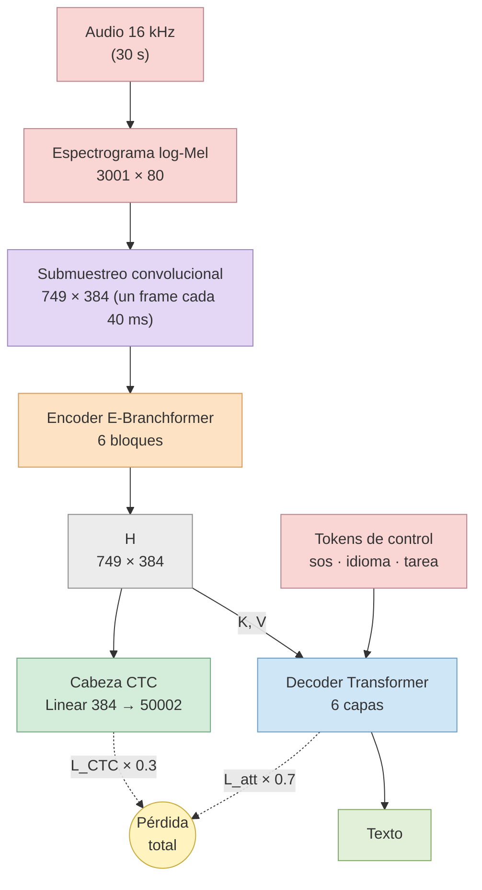
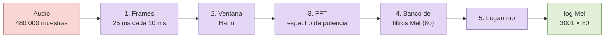
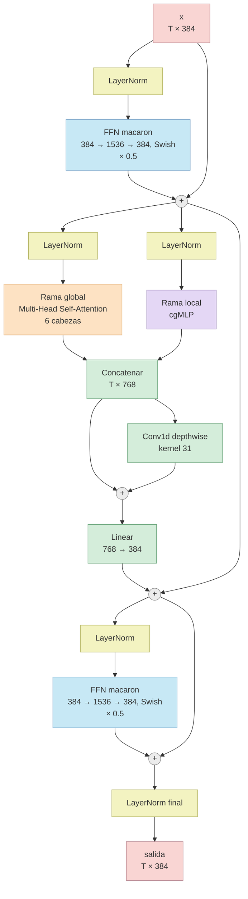
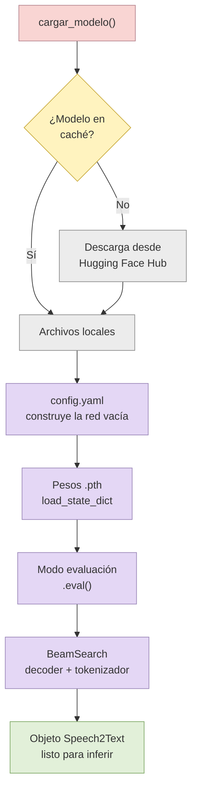
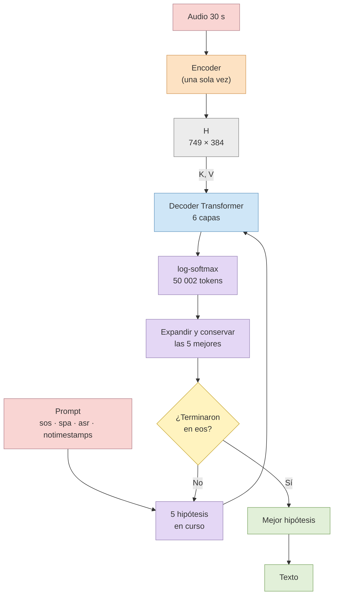
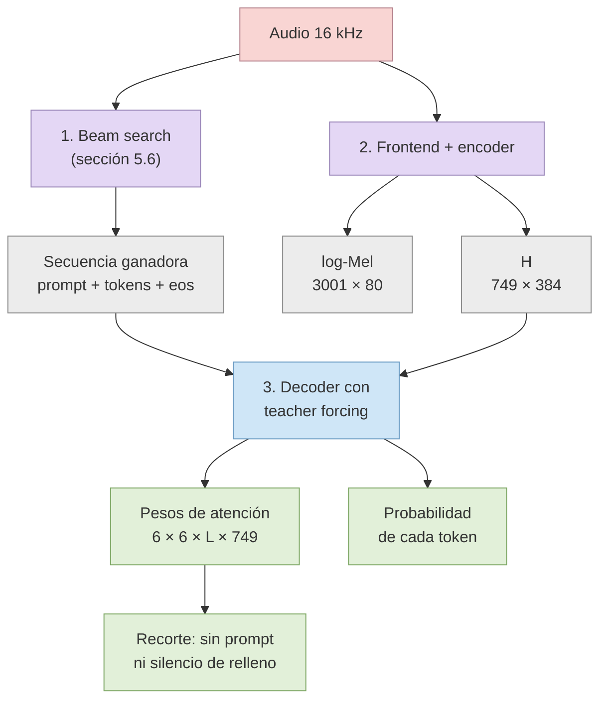
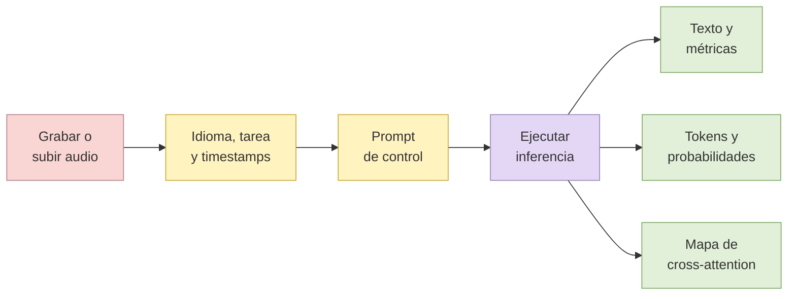

# OWSM v3.1: Inferencia y análisis de un Transformer encoder–decoder para voz a texto

Proyecto final — Procesamiento de Datos Secuenciales

**Integrantes:** _(completar nombres completos)_

---

## Contenido

1. [Resumen](#1-resumen)
2. [Introducción](#2-introducción)
3. [Marco teórico](#3-marco-teórico)
4. [Metodología](#4-metodología)
5. [Desarrollo e implementación](#5-desarrollo-e-implementación)
6. [Resultados y análisis](#6-resultados-y-análisis)
7. [Conclusiones](#7-conclusiones)
8. [Referencias](#8-referencias)

---

## 1. Resumen

> _Pendiente: se escribe al final, cuando estén los resultados._

---

## 2. Introducción

**Artículo base:** *OWSM v3.1: Better and Faster Open Whisper-Style Speech Models
based on E-Branchformer* (Peng et al., Interspeech 2024) [1] —
[arXiv:2401.16658](https://arxiv.org/abs/2401.16658)

**Repositorio original:** [ESPnet](https://github.com/espnet/espnet) ·
**Pesos:** [`espnet/owsm_v3.1_ebf_base`](https://huggingface.co/espnet/owsm_v3.1_ebf_base)

### Contexto

Con el crecimiento de la inteligencia artificial de código abierto, ha cobrado
importancia contar con modelos fundacionales completamente abiertos. En el caso
de los modelos de voz a texto, Whisper [2] ofrece un desempeño destacado, pero
OpenAI no publicó sus datos de entrenamiento ni el código para entrenarlo, lo
que impide reproducirlo, auditarlo o estudiarlo científicamente.

Como respuesta, Open Whisper-style Speech Model (OWSM) [3] busca reproducir el
entrenamiento de Whisper utilizando únicamente datos públicos y herramientas de
código abierto (180 mil horas de audio en 151 idiomas), y publica el código, los
pesos y los registros de entrenamiento. Sus versiones v1 a v3 se basan en la
arquitectura Transformer estándar.

La versión 3.1 presenta una familia de modelos que reemplaza el encoder por un
E-Branchformer [4] y mantiene el decoder como un Transformer tradicional. Con
este cambio, y sin datos adicionales, supera a OWSM v3 en la mayoría de las
pruebas y es hasta un 25 % más rápido en inferencia. Se publicó en tres tamaños:
base (101M), small (367M) y medium (1.02B parámetros).

### Motivación y objetivo

Elegimos OWSM v3.1 porque es un Transformer encoder–decoder aplicado a datos
secuenciales (audio → texto), con modificaciones al encoder que extienden el conocimiento
visto en clase, además es completamente abierto y su versión base puede
ejecutarse sin GPU.

El objetivo de este proyecto es entender la arquitectura del modelo OWSM v3.1, implementar la inferencia de su modelo
base y construir una interfaz interactiva que permita cargar audio, observar la
salida del modelo y analizar su mecanismo de atención.

---

## 3. Marco teórico

### 3.1 Antecedentes

Whisper [2] es un Transformer encoder–decoder entrenado con 680 mil horas de
audio en múltiples tareas: transcribe voz en su mismo idioma o la traduce al
inglés, y la tarea se indica con tokens especiales al inicio del texto. Las
versiones v1 a v3 de OWSM [3] reproducen este enfoque con datos públicos y el
Transformer estándar; además, OWSM incorpora una pérdida CTC conjunta en el
entrenamiento. OWSM v3.1 [1] conserva este diseño, pero reemplaza el encoder por
un E-Branchformer [4].

### 3.2 Arquitectura general de OWSM v3.1

El siguiente diagrama resume el recorrido de la información, desde el audio
hasta el texto. Las dimensiones corresponden al modelo base que usamos en este
proyecto.



1. **Entrada (3.3):** el audio se ajusta a 30 s y se convierte en un
   espectrograma log-Mel de 3001 frames × 80 bandas de frecuencia.
2. **Submuestreo (3.4):** dos capas convolucionales reducen la secuencia 4
   veces, a 749 frames de 384 dimensiones.
3. **Encoder (3.5):** seis bloques E-Branchformer procesan el audio y producen
   **H**, una representación de 749 × 384 que sigue siendo audio: un vector por
   cada 40 ms.
4. **Cabeza CTC (3.6):** una rama lateral sobre H que solo se usa para calcular
   la pérdida CTC durante el entrenamiento.
5. **Decoder (3.7):** recibe los tokens de control y genera el texto token a
   token, consultando H a través de la *cross-attention*, donde H aporta las
   *keys* (K) y los *values* (V).

En el entrenamiento, el modelo combina las dos pérdidas:
**L = 0.3 · L_CTC + 0.7 · L_att**.

### 3.3 Entrada: espectrograma log-Mel

Un audio de 10 segundos a 16 kHz, en su forma cruda, son 160 000 valores entre
−1 y 1, una representación de la que el modelo no puede extraer información
fácilmente: dos fonemas que para el oído humano son idénticos, separados por
100 ms, tienen valores crudos muy diferentes.

El espectrograma log-Mel corrige esto. Representa cómo cambia la energía de las
frecuencias a lo largo del tiempo, agrupándolas en bandas según una escala que
se aproxima a la percepción auditiva humana. Se obtiene en cinco pasos:



1. **Segmentación en frames.** El audio cambia constantemente, pero en
   intervalos muy cortos se puede considerar estacionario. Se toman ventanas de
   25 ms (400 muestras) que avanzan cada 10 ms (160 muestras), de modo que se
   solapan y no se pierde información en los bordes.

2. **Ventana.** Cortar la señal para formar los frames genera distorsiones
   espectrales en los bordes. Para suavizarlos, cada frame se multiplica por una
   función de ventana; OWSM usa la ventana de Hann:

   $$w(n) = 0.5 - 0.5\cos\left(\frac{2\pi n}{N-1}\right)$$

   Este factor lleva los bordes a cero y mantiene intacta la amplitud del audio
   en la mitad del frame.

3. **Transformada rápida de Fourier (FFT) y espectro de potencia.** Se aplica la
   FFT a cada frame para pasar del dominio del tiempo al dominio de la
   frecuencia, y se calcula su espectro de potencia:

   $$P_i = |\mathrm{FFT}(x_i)|^2$$

   Para la FFT, cada frame de 400 muestras se completa con ceros hasta
   N<sub>FFT</sub> = 512, una potencia de 2.

4. **Banco de filtros Mel.** El oído humano percibe mejor los cambios en
   frecuencias bajas que en altas. Por eso, las frecuencias se agrupan en 80
   bandas siguiendo la escala Mel, que suele definirse como:

   $$m = 2595 \log_{10}\left(1 + \frac{f}{700}\right)$$

   Las bandas son estrechas en los graves y anchas en los agudos, entre 0 y
   8 kHz. ESPnet usa la variante de Slaney de esta escala: lineal por debajo de
   1 kHz y logarítmica por encima.

5. **Logaritmo.** Se aplica el logaritmo a la energía de cada banda, porque el
   oído también percibe la intensidad de forma logarítmica:

   $$\text{log-Mel} = \log(E_{mel} + \varepsilon)$$

   donde ε es un valor muy pequeño que evita calcular log(0).

Para un audio de 30 s, el resultado es una matriz de **3001 × 80**: 3000 frames
(uno cada 10 ms) más uno adicional, porque el primer frame se centra en el
instante 0; y 80 bandas de frecuencia. Finalmente, cada banda se normaliza con
la media y la varianza calculadas sobre todos los datos de entrenamiento.

### 3.4 Submuestreo convolucional

Antes de entrar al encoder, el log-Mel pasa por un bloque de submuestreo que
reduce la longitud de la secuencia y lleva cada frame a la dimensión del modelo
(384 en la versión base):

```mermaid
flowchart LR
    A["log-Mel<br/>1 × 3001 × 80"] --> B["Conv2d 1 → 384<br/>kernel 3, stride 2<br/>+ ReLU"]
    B --> C["384 × 1500 × 39"]
    C --> D["Conv2d 384 → 384<br/>kernel 3, stride 2<br/>+ ReLU"]
    D --> E["384 × 749 × 19"]
    E --> F["Aplanar<br/>749 × 7296"]
    F --> G["Linear<br/>7296 → 384"]
    G --> H["+ Codificación<br/>posicional"]
    H --> I["X<br/>749 × 384"]

    classDef entrada fill:#F9D5D3,stroke:#B5838D,color:#333
    classDef capa fill:#E4D7F5,stroke:#9A86B8,color:#333
    classDef forma fill:#ECECEC,stroke:#8A8A8A,color:#333
    classDef salida fill:#E2F0D9,stroke:#7FA866,color:#333
    class A entrada
    class B,D,G,H capa
    class C,E,F forma
    class I salida
```



1. **El log-Mel como imagen.** El espectrograma se trata como una imagen de un
   solo canal (como una foto en blanco y negro): alto = 3001 (tiempo) y
   ancho = 80 (frecuencia).

2. **Dos capas Conv2d.** En `Conv2d(1 → 384)`, el 1 y el 384 son **canales**:
   la capa tiene 384 filtros de 3 × 3, y cada uno busca un patrón distinto en la
   imagen y produce su propio mapa. Con *stride* 2, cada filtro avanza de dos en
   dos, por lo que cada capa reduce el tiempo y la frecuencia a la mitad:

   $$\text{salida} = \left\lfloor \frac{\text{entrada} - \text{kernel}}{\text{stride}} \right\rfloor + 1$$

   | | Tiempo | Frecuencia |
   |---|---|---|
   | Entrada | 3001 | 80 |
   | Conv2d #1 | ⌊(3001 − 3)/2⌋ + 1 = 1500 | 39 |
   | Conv2d #2 | ⌊(1500 − 3)/2⌋ + 1 = **749** | 19 |

3. **Aplanar y proyectar.** En cada uno de los 749 instantes quedan 384 canales
   × 19 franjas de frecuencia = 7296 valores. Se juntan en un solo vector y una
   capa lineal lo comprime a 384. Desde aquí la frecuencia deja de ser un eje
   separado: queda codificada dentro de los 384 valores de cada frame.

4. **Codificación posicional.** La atención no conoce el orden de los frames, así
   que a cada uno se le suma un vector que indica su posición. Como en el
   entrenamiento tipo Whisper el audio siempre dura 30 s, los autores usan la
   codificación **sinusoidal absoluta** [1], la misma del Transformer original:

   $$PE_{(pos,\,2i)} = \sin\left(\frac{pos}{10000^{2i/d}}\right), \qquad PE_{(pos,\,2i+1)} = \cos\left(\frac{pos}{10000^{2i/d}}\right)$$

   con d = 384. Antes de sumarla, ESPnet multiplica la entrada por √d.

**¿Por qué reducir la secuencia?** La self-attention compara todos los frames
contra todos, por lo que su costo crece con el cuadrado de la longitud. Con 749
frames en lugar de 3001 hay unas 16 veces menos comparaciones. Cada frame pasa
a representar **40 ms** de audio, resolución suficiente para el habla, ya que
un fonema dura entre 50 y 100 ms. Whisper reduce la secuencia solo a la mitad
(20 ms por frame); según los autores, el mayor salto temporal de OWSM v3.1 es
una de las razones de su inferencia más rápida [1].

### 3.5 Encoder E-Branchformer

El encoder está formado por **6 bloques E-Branchformer** iguales [4]. Cada bloque
recibe una secuencia de T × 384 (T = 749) y entrega otra del mismo tamaño. La
idea central es procesar el audio con **dos ramas en paralelo**: una global, que
relaciona frames lejanos, y una local, que captura patrones cercanos en el
tiempo. Los autores eligieron este encoder porque converge más rápido que el
Transformer y el Conformer [1].



1. **FFN macaron.** En lugar de una sola red *feed-forward* después de la
   atención, hay dos "a la mitad" (multiplicadas por 0.5), una antes y otra
   después de las ramas, como el pan de un sándwich. Esta idea, tomada del
   Conformer, ayuda a mejorar la estabilidad.

2. **Rama global: Multi-Head Self-Attention.** La entrada de esta rama es el
   resultado de la primera FFN macaron (ya sumado a su conexión residual),
   normalizado con LayerNorm. Llamémosla Z (749 × 384). Las *queries* (Q),
   *keys* (K) y *values* (V) se generan a partir de esa misma Z, multiplicándola
   por tres matrices de pesos aprendidas:

   $$Q = ZW_Q, \qquad K = ZW_K, \qquad V = ZW_V$$

   Cada frame compara su *query* con las *keys* de todos los frames; el
   resultado se normaliza con softmax y se usa para ponderar los *values*:

   $$\text{Attention}(Q, K, V) = \text{softmax}\left(\frac{QK^\top}{\sqrt{d_k}}\right)V$$

   La matriz de pesos softmax(QKᵀ/√d<sub>k</sub>) es de 749 × 749: indica
   cuánto mira cada frame a cada uno de los demás. Este cálculo se hace en
   **6 cabezas** en paralelo, cada una con sus propias matrices y
   d<sub>k</sub> = 64 (6 × 64 = 384); sus salidas se concatenan y pasan por una
   capa lineal. Así, cada frame puede mirar los 749 frames del audio y la rama
   captura el contexto de toda la frase.

3. **Rama local: cgMLP** (*Convolutional Gating MLP*). Captura patrones cercanos
   en el tiempo, como fonemas y transiciones entre sonidos:
   - Una capa lineal expande de 384 a 1536 (con GELU) y el resultado se divide
     en dos mitades de 768: x<sub>r</sub> y x<sub>g</sub>.
   - x<sub>g</sub> pasa por una **convolución 1D depthwise** de kernel 31 a lo
     largo del tiempo, es decir, mira 31 frames vecinos (≈1.2 s de audio).
   - x<sub>g</sub> actúa como **compuerta**: se multiplica elemento a elemento
     por la otra mitad (x<sub>r</sub> ⊙ x<sub>g</sub>), decidiendo cuánto deja
     pasar de cada canal según el contexto cercano.
   - Una capa lineal vuelve de 768 a 384.

   La convolución es 1D porque, tras el submuestreo, solo el tiempo tiene
   vecinos (la frecuencia ya está codificada dentro de los 384 valores). Es
   *depthwise* porque cada canal tiene su propio filtro: así necesita unos 24 mil
   parámetros, en lugar de los 18 millones de una convolución completa.

4. **Fusión mejorada.** Las salidas de las dos ramas se concatenan (T × 768), se
   les suma una convolución 1D depthwise que mezcla información de frames
   vecinos entre ambas ramas, y una capa lineal regresa a 384. Esta fusión es la
   mejora del E-Branchformer (*Enhanced*) frente al Branchformer original.

5. **Normalización y conexiones residuales.** Cada componente se normaliza
   *antes* de aplicarse (*pre-LN*) y se suma a su entrada mediante una conexión
   residual: hay tres por bloque (las dos FFN y la fusión de las ramas). El
   bloque termina con una LayerNorm final.

| | Encoder Transformer | Bloque E-Branchformer |
|---|---|---|
| Estructura | MHA → Add & Norm → FFN → Add & Norm | FFN½ → (MHA ∥ cgMLP) → fusión → FFN½ |
| Contexto local | No tiene | Convolución depthwise (≈1.2 s) |
| Normalización | Después de sumar (*post-LN*) | Antes de cada componente (*pre-LN*) |
| Conexiones residuales | 2 por bloque | 3 por bloque |

Después de los 6 bloques y una LayerNorm, la salida del encoder es **H**, de
749 × 384: una representación del audio con un vector por cada 40 ms, que pasa a
la cabeza CTC y al decoder.

### 3.6 Cabeza CTC y pérdida conjunta

OWSM entrena con un mecanismo híbrido, incorporado en OWSM [3] y heredado por
la v3.1: combina la pérdida de **clasificación temporal conexionista** (CTC,
*Connectionist Temporal Classification*) sobre el encoder con la pérdida de
entropía cruzada del decoder basado en atención.

**El problema que resuelve CTC.** Tenemos muchos frames de audio y pocos tokens
de texto: 1 s de audio son 25 frames del encoder, mientras que la palabra "hola"
son apenas unos pocos tokens. Para entrenar haría falta saber qué frame
corresponde a qué token (por ejemplo, que la "h" está en los frames 3 a 5), pero
los datos de entrenamiento no traen ese detalle: solo traen el audio y su
transcripción completa.

**La cabeza CTC.** Es una sola capa lineal aplicada a cada frame de H por separado:

```
H (749 × 384)  →  Linear 384 → 50002  →  softmax  →  749 × 50002
```

Para cada frame de 40 ms predice un símbolo entre los ≈50 mil tokens del
vocabulario, más un símbolo especial **_ (blank)**, que significa "aquí no se
emite nada nuevo". La predicción se convierte en texto juntando los símbolos
repetidos consecutivos y borrando los blanks:

```
frames:      1  2  3  4  5  6  7  8  9  10
predicción:  _  h  h  o  _  _  l  a  a  _
resultado:   "hola"
```

**La pérdida CTC.** Hay muchas predicciones posibles (caminos) que, tras aplicar
esta regla, dan el texto correcto. CTC no necesita saber cuál es la verdadera:
**suma la probabilidad de todos los caminos** que producen la transcripción y maximiza esa suma:

$$P(y \mid x) = \sum_{\pi \,\to\, y} \; \prod_{t=1}^{T} p_t(\pi_t), \qquad \mathcal{L}_{CTC} = -\log P(y \mid x)$$

donde π es un camino, con un símbolo por frame. La suma sobre todos los caminos
se calcula eficientemente con programación dinámica. El texto de referencia se
convierte en índices de tokens con el mismo tokenizador del modelo (por ejemplo,
"hola cómo estás" → `[13944, 1721, 18111, 5818, 1687]`), y esos índices indican
qué columnas de la salida 749 × 50002 se leen en cada frame.

Por su regla de colapso, CTC fuerza un **orden monótono**: el texto avanza en el
mismo orden que el audio, lo que es ideal para la transcripción. Esto obliga al
encoder a producir representaciones bien alineadas en el tiempo.

**Una rama lateral.** H no se transforma en texto antes de llegar al decoder: se
copia completo (749 × 384) hacia dos destinos independientes, la cabeza CTC y la
*cross-attention* del decoder. Las dos ramas no se pasan información; se
relacionan a través de la pérdida total:

$$\mathcal{L} = \lambda_1 \, \mathcal{L}_{CTC} + \lambda_2 \, \mathcal{L}_{att}, \qquad \lambda_1 + \lambda_2 = 1$$

Para OWSM v3.1, λ<sub>1</sub> = 0.3 y λ<sub>2</sub> = 0.7 (valor `ctc_weight: 0.3`
en la configuración publicada del modelo). En la retropropagación, los gradientes
de ambas pérdidas se suman en el encoder compartido: así, CTC organiza el
encoder y el decoder se beneficia al consultar un H mejor alineado. Según los
autores, esta pérdida conjunta ayuda a estabilizar y acelerar la convergencia [3].

---

## 4. Metodología

Este proyecto no entrena el modelo: usa los pesos publicados por los autores y
se concentra en implementar la inferencia, inspeccionar el mecanismo de atención
y presentarlo en una interfaz interactiva. Esta sección describe cómo se
organizó el trabajo, qué herramientas se usaron y qué decisiones se tomaron
sobre los pesos y la decodificación. La sección 5 muestra cómo esas decisiones
se convierten en código.

### 4.1 Proceso de implementación

El trabajo se organizó en siete fases. Cada una se apoya en la anterior: primero
se comprobó que el modelo funciona en nuestro hardware y solo después se
construyó encima.


1. **Selección del artículo.** Se buscó un Transformer encoder–decoder para
   datos secuenciales que tuviera artículo reciente, código y pesos públicos.
   OWSM v3.1 [1] cumple las tres condiciones: el artículo es de 2024, el código
   está en ESPnet [5] y los pesos están en Hugging Face.

2. **Estudio de la arquitectura.** Se leyó el artículo junto con el
   `config.yaml` del modelo publicado, que describe capa por capa la red que se
   ejecuta. De ahí salen las dimensiones de la sección 3 (3001 × 80, 749 × 384,
   6 bloques, 6 cabezas).

3. **Prueba mínima por consola** (`scripts/prueba_inferencia.py`). Antes de
   escribir la interfaz se verificó que el modelo se descarga, carga y transcribe
   un audio en un computador sin GPU. Se midieron el número de parámetros, el
   tiempo de carga, el tiempo de inferencia y la memoria RAM.

4. **Extracción de la cross-attention** (`owsm_demo/atencion.py`). ESPnet
   devuelve el texto, pero no los pesos de atención. Se implementó una segunda
   pasada por el decoder para recuperar la matriz softmax(QKᵀ/√d<sub>k</sub>) de
   las 6 capas y las 6 cabezas (sección 5.7).

5. **Visualización** (`owsm_demo/graficos.py`). Se dibujan el log-Mel de entrada
   y el mapa de atención con el mismo eje de tiempo, para ver qué parte del
   audio usó el decoder al generar cada token.

6. **Interfaz interactiva** (`app.py`). Una aplicación en Streamlit permite
   grabar o subir un audio, elegir idioma y tarea, ejecutar la inferencia y
   explorar la atención por capa y por cabeza.

7. **Pruebas y análisis.** Se ejecutaron audios propios en distintos idiomas y
   tareas para obtener los resultados de la sección 6.

### 4.2 Herramientas utilizadas

| Herramienta | Versión | Uso en el proyecto |
|---|---|---|
| Python | 3.12 | Lenguaje del proyecto (`.python-version`). |
| [uv](https://docs.astral.sh/uv/) | — | Gestor del entorno y las dependencias. El archivo `uv.lock` fija la versión exacta de cada paquete, así el entorno es idéntico en cualquier computador. |
| PyTorch / torchaudio | 2.12 / 2.11 | Motor de tensores sobre el que corre la red, en CPU o GPU. |
| ESPnet [5] | 202611 | *Toolkit* con el que los autores entrenaron OWSM. Su clase `Speech2Text` construye la red desde `config.yaml`, carga los pesos y ejecuta el *beam search*. |
| espnet_model_zoo / Hugging Face Hub | 0.1.7 / 2.4 | Descarga de los pesos preentrenados y del resto de archivos del modelo. |
| librosa / soundfile | 0.11 / 0.14 | Lectura de audio (wav, mp3, flac, ogg), conversión a mono y remuestreo a 16 kHz. |
| matplotlib | 3.11 | Gráficos del log-Mel y de los mapas de atención. |
| Streamlit | 1.67 | Interfaz web interactiva. |
| psutil | 7.2 | Medición de la RAM usada en la prueba por consola. |

### 4.3 Uso de pesos preentrenados

No se entrena ni se ajusta (*fine-tuning*) el modelo. Reproducir el
entrenamiento requiere 180 mil horas de audio y un clúster de GPUs [1], lo que
está fuera del alcance del proyecto y de su objetivo: entender la arquitectura e
implementar su inferencia.

**Qué publican los autores.** El repositorio
[`espnet/owsm_v3.1_ebf_base`](https://huggingface.co/espnet/owsm_v3.1_ebf_base)
contiene todo lo necesario para reconstruir el modelo exactamente como se
entrenó:

| Archivo | Contenido |
|---|---|
| `config.yaml` | Descripción completa de la red (tipo de encoder y decoder, capas, dimensiones, cabezas), la configuración del log-Mel (`n_fft: 512`, `win_length: 400`, `hop_length: 160`), el preprocesador (ventana de 30 s) y la lista de los **50 002 tokens** del vocabulario. |
| `valid.total_count.ave_5best.pth` | Los pesos (≈405 MB). El nombre indica que son el **promedio de los 5 mejores checkpoints** según el conjunto de validación, una técnica que suele dar un modelo más estable que el último checkpoint. |
| `bpe.model` | Tokenizador SentencePiece [6] de tipo *unigram* con 50 000 subpalabras. Convierte texto en tokens y tokens en texto. |
| `feats_stats.npz` | Media y varianza de cada banda del log-Mel sobre los datos de entrenamiento, usadas en la normalización (sección 3.3). |
| `meta.yaml` | Versiones con que se entrenó el modelo (ESPnet 202308, PyTorch 1.13.1) y la ruta de cada archivo. |

**Elección del tamaño.** OWSM v3.1 se publicó en tres tamaños. Los tres
comparten la misma arquitectura (sección 3.2): solo cambian el ancho y la
profundidad.

| Modelo | Parámetros | Dimensión d | Bloques del encoder | Capas del decoder |
|---|---|---|---|---|
| **base** (usado) | 101M | 384 | 6 | 6 |
| small | 367M | 768 | 9 | 9 |
| medium | 1.02B | 1024 | 18 | 18 |

Se eligió el modelo **base** por tres razones: corre en CPU sin GPU, ocupa unos
400 MB y responde en pocos segundos, algo necesario para una demostración en
vivo. El costo es una menor precisión que la de los modelos más grandes [1]. Como
la arquitectura es la misma, todo lo explicado en la sección 3 aplica igual a
los tres tamaños.

### 4.4 Configuración de la decodificación

Como se vio en la sección 3.6, el modelo tiene dos salidas sobre H: la cabeza CTC
y el decoder. En inferencia, ESPnet puede usarlas por separado o combinarlas. Para
cada hipótesis de texto *y* calcula un puntaje:

$$\text{score}(y) = (1 - \lambda)\,\log p_{att}(y \mid H) + \lambda\,\log p_{CTC}(y \mid H)$$

| λ (`ctc_weight`) | Búsqueda | Quién decide el texto |
|---|---|---|
| **0** (usado) | Beam search de atención | Solo el decoder |
| 0 < λ < 1 | Beam search híbrido | Decoder y CTC |
| 1 | Beam search CTC | Solo la cabeza CTC |

El `ctc_weight` de la inferencia no es el mismo que el del entrenamiento. En el
entrenamiento (0.3) pondera las **pérdidas**; en la inferencia pondera los
**puntajes** de las hipótesis. Comparten el nombre, pero son independientes.

**¿Por qué λ = 0?** El objetivo es analizar la *cross-attention* del decoder. Con
λ = 0, cada token del texto lo elige únicamente el decoder, que consulta H a
través de esa atención. Así, el mapa de atención de la sección 5.7 explica por
completo la salida. Con λ > 0, parte de la decisión vendría de la cabeza CTC, que
no usa esa atención. El costo es que la decodificación híbrida suele ser algo más
robusta frente a repeticiones u omisiones.

Los demás parámetros de la decodificación son:

| Parámetro | Valor | Significado |
|---|---|---|
| `beam_size` | 5 | Número de hipótesis que se mantienen en cada paso del beam search (sección 5.6). |
| `ctc_weight` | 0.0 | Decodificación solo con el decoder. |
| `maxlenratio` | 0.0 | Longitud máxima de la salida igual a la longitud de H (749 tokens). La búsqueda se detiene antes, cuando las hipótesis terminan en `<eos>`. |
| `penalty` | 0.0 | Sin bonificación ni castigo por longitud. |
| `nbest` | 1 | Solo se devuelve la mejor hipótesis. |
| `lang_sym` / `task_sym` | `<spa>` / `<asr>` | Idioma y tarea por defecto. La interfaz los cambia en cada inferencia (sección 5.5). |
| `predict_time` | `False` | Sin marcas de tiempo, salvo que el usuario las active. |
| `device` | automático | `cuda` si hay GPU, si no `cpu`. |

---

## 5. Desarrollo e implementación

Esta sección recorre el código en el mismo orden en que viaja la información:
cómo ejecutar el proyecto, cómo se cargan los pesos, cómo se prepara el audio,
cómo se genera el texto, cómo se extrae la atención y cómo se muestra todo en la
interfaz.

### 5.1 Estructura del repositorio

```
owsm-ebranchformer-v31/
├── pyproject.toml            # dependencias del proyecto
├── uv.lock                   # versiones exactas (entorno reproducible)
├── .python-version           # Python 3.12
├── app.py                    # interfaz Streamlit
├── owsm_demo/
│   ├── modelo.py             # caché, carga del modelo, lectura de audio, transcripción
│   ├── atencion.py           # inferencia + extracción de la cross-attention
│   └── graficos.py           # log-Mel y mapas de calor de atención
├── scripts/
│   └── prueba_inferencia.py  # prueba por consola con tiempo y RAM
└── docs/                     # documentación de apoyo
```

| Módulo | Responsabilidad |
|---|---|
| `owsm_demo/modelo.py` | Configura el caché, carga `Speech2Text` con los parámetros de la sección 4.4, lee el audio y lo convierte a 16 kHz mono. |
| `owsm_demo/atencion.py` | Ejecuta la inferencia y extrae los pesos de *cross-attention*, el log-Mel y la probabilidad de cada token. |
| `owsm_demo/graficos.py` | Dibuja el log-Mel y el mapa de atención con el mismo eje de tiempo, y la comparación entre cabezas. |
| `app.py` | Interfaz: entrada de audio, configuración, ejecución, salidas y visualización. |

### 5.2 Pasos para ejecutar el proyecto

**Requisitos:** [uv](https://docs.astral.sh/uv/) instalado, conexión a internet
la primera vez, unos 400 MB de disco para el modelo y 1.5 GB de RAM libre. No
requiere GPU.

```bash
# 1. Clonar el repositorio
git clone https://github.com/sebasjp/owsm-ebranchformer-v31
cd owsm-ebranchformer-v31

# 2. Crear el entorno e instalar las dependencias (lee pyproject.toml y uv.lock)
uv sync

# 3. Ejecutar la interfaz (se abre en http://localhost:8501)
uv run streamlit run app.py
```

También se puede probar el modelo sin interfaz:

```bash
uv run python scripts/prueba_inferencia.py ruta/al/audio.wav --idioma "<spa>" --tarea "<asr>"
```

Este script imprime el dispositivo, el número de parámetros, el tiempo de carga,
el tiempo de inferencia, la RAM usada, los tokens generados y el texto.

La primera ejecución descarga el modelo desde Hugging Face. Las siguientes lo
leen del caché local.

### 5.3 Carga de los pesos preentrenados

Toda la carga ocurre en una sola llamada de `owsm_demo/modelo.py`:

```python
MODELO_HF = "espnet/owsm_v3.1_ebf_base"

Speech2Text.from_pretrained(
    MODELO_HF,
    device=dispositivo(),     # "cuda" si hay GPU, si no "cpu"
    beam_size=5,
    ctc_weight=0.0,
    maxlenratio=0.0,
    lang_sym="<spa>",
    task_sym="<asr>",
    predict_time=False,
)
```

Internamente, esa llamada sigue estos pasos:



1. **Descarga.** `from_pretrained` usa `espnet_model_zoo` para bajar el
   repositorio del modelo desde Hugging Face Hub (los archivos de la sección
   4.3). Si ya están en el caché, no se descarga nada.

2. **Construcción de la red.** ESPnet lee `config.yaml` e instancia cada
   componente con sus hiperparámetros: el frontend log-Mel (3.3), la
   normalización con `feats_stats.npz`, el submuestreo Conv2d (3.4), los 6
   bloques E-Branchformer (3.5), la cabeza CTC (3.6) y el decoder de 6 capas
   (3.7). En este punto la red existe, pero sus pesos son aleatorios.

3. **Carga de los pesos.** El archivo `.pth` es un diccionario que asocia el
   nombre de cada parámetro con su tensor (por ejemplo,
   `encoder.encoders.0.attn.linear_q.weight` → 384 × 384). `load_state_dict`
   copia cada tensor en la capa correspondiente. Si la arquitectura no
   coincidiera con los pesos, este paso fallaría.

4. **Modo evaluación.** `.eval()` desactiva el *dropout* (0.05 en el
   entrenamiento) y SpecAugment, que solo se usan para regularizar durante el
   entrenamiento. Así, el mismo audio produce siempre el mismo resultado.

5. **Preparación de la búsqueda.** Se crea el objeto `BeamSearch` con el decoder
   como único evaluador (λ = 0), el tokenizador `bpe.model` y el conversor entre
   tokens e identificadores.

**Caché del modelo.** En Linux y Colab se usa el caché por defecto de Hugging Face
(`~/.cache/huggingface`). En Windows, `modelo.py` lo ubica en la raíz de la
unidad (por ejemplo, `C:\hf_cache`), porque los nombres de los archivos del modelo
son tan largos que, dentro de la carpeta del proyecto, superan el límite de 260
caracteres de las rutas de Windows. Por eso la variable `HF_HOME` se define antes
de importar ESPnet. Si el usuario ya la definió, se respeta.

**Una sola carga por servidor.** Streamlit vuelve a ejecutar `app.py` completo en
cada interacción. Para no recargar el modelo cada vez, la función que lo carga
está decorada con `@st.cache_resource`: el modelo se construye en la primera
inferencia y después se reutiliza.

### 5.4 Preprocesamiento del audio

El preprocesamiento se reparte entre nuestro código y el modelo. Nuestro código
solo entrega la forma de onda en el formato correcto; el resto lo hace el modelo
con la configuración de `config.yaml`. Así se garantiza que el audio se procese
igual que durante el entrenamiento.


En azul, los pasos de nuestro código (`cargar_audio`); en morado, los que hace
ESPnet dentro de `Speech2Text`.

1. **Lectura, mono y 16 kHz.** `librosa.load(archivo, sr=16000, mono=True)` lee
   cualquier formato soportado, promedia los canales si el audio es estéreo y lo
   remuestrea a 16 kHz. El remuestreo es necesario porque el banco de filtros
   Mel (3.3) se calculó para 16 kHz: con otra frecuencia, cada banda
   correspondería a frecuencias distintas de las aprendidas.

2. **Tipo de dato.** La señal se convierte a `float32`, con valores entre −1 y 1,
   que es el tipo que esperan los pesos del modelo.

3. **Relleno o recorte a 30 s.** `_pad_or_trim` ajusta la señal a exactamente
   16 000 × 30 = **480 000 muestras**: si es más corta, completa con ceros
   (silencio); si es más larga, corta lo que sobra. La interfaz avisa cuando el
   audio supera los 30 s, porque solo se procesan los primeros 30.

4. **log-Mel, normalización y submuestreo.** Dentro de `s2t_model.encode` se
   aplican los pasos de las secciones 3.3 y 3.4: espectrograma log-Mel de
   3001 × 80, normalización de cada banda con la media y la varianza de
   `feats_stats.npz` (`global_mvn`) y submuestreo convolucional a 749 × 384.

| Etapa | Forma | Resolución temporal |
|---|---|---|
| Forma de onda | 480 000 | 1/16 000 s por muestra |
| log-Mel | 3001 × 80 | 10 ms por frame |
| Después del submuestreo | 749 × 384 | 40 ms por frame |
| H (salida del encoder) | 749 × 384 | 40 ms por frame |

**¿Por qué rellenar con silencio?** El modelo se entrenó siempre con ventanas de
30 s, con el mismo esquema de Whisper [2]. La codificación posicional
sinusoidal (3.4) y la atención aprendieron a trabajar con 749 posiciones; darle
siempre la misma longitud evita que el modelo vea entradas distintas de las del
entrenamiento.

### 5.5 Prompt de control del decoder

El decoder no empieza a generar desde cero: recibe primero una secuencia de
tokens especiales, el *prompt*, que le indica qué hacer. Es el mismo mecanismo de
Whisper (sección 3.1). `Speech2Text._build_hyp_primer` lo construye así:

```
<sos> <idioma> <tarea> [<notimestamps>]
```

| Token | ID | Función |
|---|---|---|
| `<sos>` | 49999 | Inicio de la secuencia. |
| `<spa>` | 121 | Idioma del audio (151 idiomas posibles; `<eng>` = 31). |
| `<asr>` | 155 | Tarea: transcribir en el mismo idioma. `<st_eng>` (161) traduce al inglés, y así para cada idioma destino. |
| `<notimestamps>` | 181 | Pide texto sin marcas de tiempo. |
| `<eos>` | 50000 | Fin de la secuencia. Lo genera el modelo, no forma parte del prompt. |

Los identificadores salen de la lista de tokens del `config.yaml`: el índice de
cada token en esa lista es su ID.

Con la configuración por defecto, el prompt es `[49999, 121, 155, 181]`.
El **mismo modelo, con los mismos pesos**, transcribe o traduce según el token de
tarea que reciba. Si se activan las marcas de tiempo, se omite
`<notimestamps>` y el modelo intercala en el texto tokens como `<0.00>`,
`<1.24>`… (de 0 a 30 s en pasos de 20 ms) que indican dónde empieza y termina
cada segmento.

### 5.6 Inferencia: decodificación autorregresiva con beam search

Con H calculado y el prompt construido, el decoder genera el texto **un token a la
vez**: cada token nuevo se agrega a la entrada y se vuelve a llamar al decoder
para predecir el siguiente. El encoder se ejecuta una sola vez; el decoder, una
vez por cada token.



1. **Encoder.** El audio preprocesado pasa una sola vez por el encoder y se
   obtiene H (749 × 384). Durante toda la decodificación, H no cambia: es la
   memoria acústica que el decoder consulta.

2. **Paso del decoder.** Para cada hipótesis en curso, el decoder recibe los
   tokens generados hasta ahora (al inicio, solo el prompt). En cada una de sus
   6 capas aplica *self-attention* enmascarada sobre esos tokens y
   *cross-attention* sobre H (sección 3.7). La salida del último token pasa por
   una capa lineal de 384 → 50 002 y un log-softmax: es la log-probabilidad de
   cada token del vocabulario de ser el siguiente.

3. **Beam search.** Escoger siempre el token más probable (búsqueda *greedy*)
   puede llevar a una frase peor en conjunto: un error temprano ya no se
   corrige. El beam search mantiene las **k = 5** secuencias parciales más
   probables. En cada paso, extiende cada una con sus mejores candidatos, suma
   los puntajes y conserva solo las 5 mejores del total. El puntaje de una
   hipótesis es la suma de las log-probabilidades de sus tokens:

   $$\text{score}(y_{1:i}) = \sum_{j=1}^{i} \log p\left(y_j \mid y_{<j},\, H\right)$$

4. **Fin de la búsqueda.** Una hipótesis termina cuando genera `<eos>`. La
   búsqueda se detiene cuando no quedan hipótesis abiertas, cuando la regla de
   detección de fin de ESPnet determina que las hipótesis más recientes tienen
   puntajes muy inferiores al de la mejor ya terminada, o al llegar al máximo de
   749 tokens (`maxlenratio = 0`, sección 4.4). Se devuelve la hipótesis
   terminada con mayor puntaje.

5. **Posprocesamiento.** La secuencia ganadora, por ejemplo
   `[<sos>, <spa>, <asr>, <notimestamps>, ▁hola, ▁mundo, <eos>]`, se limpia:
   - se quitan el prompt y `<eos>`;
   - los IDs se convierten en tokens con la lista del vocabulario;
   - el tokenizador SentencePiece une los tokens en texto. El símbolo `▁` marca
     el inicio de una palabra y se reemplaza por un espacio;
   - se obtienen dos versiones: el texto crudo, con tokens especiales como las
     marcas de tiempo, y el texto limpio, sin ellos.

La función `transcribir()` de `modelo.py` ejecuta exactamente este proceso y
devuelve el texto y los tokens. La interfaz usa una versión extendida, descrita a
continuación.

### 5.7 Extracción de la cross-attention

ESPnet entrega el texto, pero no los pesos de atención que lo produjeron. La
función `inferir_con_atencion()` de `owsm_demo/atencion.py` los recupera en tres
etapas:



1. **Beam search normal.** Se decodifica como en la sección 5.6 y se guarda la
   secuencia ganadora completa (`hyp.yseq`), incluido el prompt.

2. **Encoder.** Se repite el preprocesamiento y se llama por separado al frontend
   y al encoder, para conservar dos tensores que el beam search no devuelve: el
   log-Mel (3001 × 80), que se dibuja en la interfaz, y H (749 × 384). Con ellos
   se calcula también cuántos segundos representa cada frame de H:
   30 s / 749 ≈ **40 ms**.

3. **Decoder con *teacher forcing*.** Se le entrega al decoder, de una sola vez,
   la secuencia ganadora sin `<eos>` junto con H. Como el decoder usa una máscara
   causal, cada posición ve exactamente los mismos tokens previos que vio durante
   el beam search, así que la atención resultante es la misma que produjo el
   texto. En cada capa, la *cross-attention* calcula:

   $$Q = S\,W_Q \;\; (L \times 384), \qquad K = H\,W_K \;\; (749 \times 384), \qquad V = H\,W_V \;\; (749 \times 384)$$

   $$A = \text{softmax}\left(\frac{QK^\top}{\sqrt{d_k}}\right) \;\; (L \times 749)$$

   donde S son los estados del decoder después de su *self-attention* (uno por
   token) y L es el número de tokens. Las *queries* vienen del texto; las *keys*
   y los *values*, del audio. La fila *i* de A dice a qué frames de 40 ms miró el
   decoder para predecir el token *i* + 1. Cada capa guarda A en
   `src_attn.attn`, y al apilar las 6 capas, cada una con sus 6 cabezas
   (d<sub>k</sub> = 64), se obtiene un tensor de **6 × 6 × L × 749**.

4. **Desactivar SDPA.** PyTorch tiene implementaciones optimizadas de la atención
   (*scaled dot-product attention* y *flash attention*) que calculan el
   resultado sin guardar la matriz A. Para poder leerla, se activa
   temporalmente la implementación manual de ESPnet y, al terminar, se restaura
   la configuración original (bloque `try / finally`).

5. **Probabilidad de cada token.** Con los *logits* de esta misma pasada se
   aplica softmax y se lee la probabilidad que el decoder asignó al token que
   finalmente se eligió. Es la medida de confianza que muestra la interfaz.

6. **Recorte.** Se eliminan las filas que corresponden al prompt (solo interesan
   los tokens generados por el modelo) y las columnas posteriores al final del
   audio real, que solo contienen el silencio de relleno.

**¿Por qué no leer la atención durante el beam search?** El beam search mantiene
5 hipótesis a la vez y en cada paso descarta la mayoría, por lo que la atención
calculada mezcla la de hipótesis que no sobrevivieron. Con *teacher forcing* se
recalcula en una sola pasada y únicamente para la secuencia ganadora.

### 5.8 Interfaz de visualización

`app.py` organiza la interfaz en el mismo orden del proceso: entrada,
configuración, inferencia, salida y atención.



1. **Entrada.** El audio se graba desde el micrófono (`st.audio_input`) o se sube
   como archivo wav, mp3, flac u ogg. La interfaz muestra un reproductor, la
   duración, la frecuencia de muestreo y el número de muestras.

2. **Configuración.** En la barra lateral se elige el idioma del audio (8
   opciones), la tarea (transcribir o traducir a inglés, español, francés,
   alemán o portugués) y si se predicen marcas de tiempo. Con esa selección se
   muestra el prompt exacto que recibirá el decoder. La barra lateral muestra
   también la fecha, el dispositivo (CPU o CUDA) y el modelo usado.

3. **Inferencia.** Al presionar *Ejecutar inferencia* se llama a
   `inferir_con_atencion()` y el resultado se guarda en `st.session_state`. Así,
   cambiar de capa o de cabeza en el mapa de atención no repite la inferencia:
   solo se vuelve a dibujar.

4. **Salida.** Se muestran el texto generado y cuatro métricas:

   | Métrica | Cálculo | Interpretación |
   |---|---|---|
   | Tiempo de inferencia | segundos medidos con `time.perf_counter()` | Incluye el beam search y la extracción de atención. |
   | Tokens generados | número de tokens después del prompt | Longitud de la salida en subpalabras, no en palabras. |
   | RTF (*Real-Time Factor*) | tiempo de inferencia / duración del audio | Menor que 1: más rápido que el tiempo real. |
   | Confianza media | promedio de p(token elegido) | Valores bajos suelen señalar palabras dudosas o errores. |

   Un desplegable muestra el texto crudo, con tokens especiales, y la tabla de
   tokens con la probabilidad de cada uno.

5. **Cross-attention.** Un gráfico doble comparte el eje de tiempo:
   - **Arriba:** el log-Mel que entra al encoder (80 bandas, 10 ms por frame).
   - **Abajo:** el mapa de atención A. Cada fila es un token generado (*query*) y
     cada columna, un frame de H de 40 ms (*key*).

   Se puede ver el promedio de todas las capas y cabezas, o una capa y una cabeza
   en particular. Al elegir una capa, un desplegable muestra sus 6 cabezas lado a
   lado para comparar en qué se especializa cada una. En transcripción se espera
   un patrón aproximadamente **diagonal**: las palabras se escriben en el mismo
   orden en que se pronunciaron.

---

## 6. Resultados y análisis


---

## 7. Conclusiones


---

## 8. Referencias

> _Formato IEEE. Lista en construcción: cada sección agrega sus referencias y al
> final se unifica la numeración._

[1] Y. Peng, J. Tian, W. Chen, S. Arora, B. Yan, Y. Sudo, M. Shakeel, K. Choi, J. Shi, X. Chang, J.-w. Jung, and S. Watanabe, "OWSM v3.1: Better and faster open Whisper-style speech models based on E-Branchformer," in *Proc. Interspeech*, 2024. [Online]. Available: https://arxiv.org/abs/2401.16658

[2] A. Radford, J. W. Kim, T. Xu, G. Brockman, C. McLeavey, and I. Sutskever, "Robust speech recognition via large-scale weak supervision," in *Proc. ICML*, 2023.

[3] Y. Peng, J. Tian, B. Yan, *et al.*, "Reproducing Whisper-style training using an open-source toolkit and publicly available data," in *Proc. ASRU*, 2023.

[4] K. Kim, F. Wu, Y. Peng, *et al.*, "E-Branchformer: Branchformer with enhanced merging for speech recognition," in *Proc. SLT*, 2023.

[5] S. Watanabe, T. Hori, S. Karita, T. Hayashi, J. Nishitoba, Y. Unno, N. E. Y. Soplin, J. Heymann, M. Wiesner, N. Chen, A. Renduchintala, and T. Ochiai, "ESPnet: End-to-end speech processing toolkit," in *Proc. Interspeech*, 2018, pp. 2207–2211.

[6] T. Kudo and J. Richardson, "SentencePiece: A simple and language independent subword tokenizer and detokenizer for neural text processing," in *Proc. EMNLP: System Demonstrations*, 2018, pp. 66–71.
