# OWSM v3.1: Inferencia y análisis de un Transformer encoder–decoder para voz a texto

Proyecto final — Procesamiento de Datos Secuenciales

**Integrantes:** _(completar nombres completos)_

---

## Contenido

1. [Resumen](#1-resumen)
2. [Introducción](#2-introducción)
3. [Marco teórico](#3-marco-teórico)
4. [Metodología](#4-metodología)
5. [Desarrollo e implementación](#5-desarrollo-e-implementación)
6. [Resultados y análisis](#6-resultados-y-análisis)
7. [Conclusiones](#7-conclusiones)
8. [Referencias](#8-referencias)

---

## 1. Resumen

Este trabajo estudia e implementa la inferencia de OWSM v3.1 [1], un modelo
abierto de voz a texto al estilo de Whisper [2] que combina un encoder
E-Branchformer [4] con un decoder Transformer. Usamos el modelo base (101M
parámetros) con los pesos publicados por los autores y el *toolkit* ESPnet [5],
sin entrenar ni ajustar el modelo. Sobre él construimos una aplicación
interactiva que graba o recibe un audio, lo transcribe o lo traduce según el
idioma y la tarea indicados en el *prompt*, y muestra los pesos de la
*cross-attention* del decoder (6 capas × 6 cabezas), es decir, a qué instantes
del audio mira el modelo para escribir cada token. En el marco teórico se
explica el recorrido completo del audio al texto: el espectrograma log-Mel, el
encoder con sus ramas global y local, la creación de los tensores Q, K y V, el
formato multitarea con tokens especiales y la decodificación con *beam search*.
La aplicación funciona de extremo a extremo en CPU: en nuestra prueba, una
frase de 3.7 s en español se transcribió correctamente en 21 s, incluyendo
el *beam search* y la extracción de la atención. Según las métricas
publicadas, el modelo base es el más rápido de su familia y supera en promedio
a Whisper base en reconocimiento en inglés, pero es débil en identificación de
idioma, traducción y audio largo, limitaciones que analizamos en la sección 6.

---

## 2. Introducción

**Artículo base:** *OWSM v3.1: Better and Faster Open Whisper-Style Speech Models
based on E-Branchformer* (Peng et al., Interspeech 2024) [1] —
[arXiv:2401.16658](https://arxiv.org/abs/2401.16658)

**Repositorio original:** [ESPnet](https://github.com/espnet/espnet) ·
**Pesos:** [`espnet/owsm_v3.1_ebf_base`](https://huggingface.co/espnet/owsm_v3.1_ebf_base)

### Contexto

Con el crecimiento de la inteligencia artificial de código abierto, ha cobrado
importancia contar con modelos fundacionales completamente abiertos. En el caso
de los modelos de voz a texto, Whisper [2] ofrece un desempeño destacado, pero
OpenAI no publicó sus datos de entrenamiento ni el código para entrenarlo, lo
que impide reproducirlo, auditarlo o estudiarlo científicamente.

Como respuesta, Open Whisper-style Speech Model (OWSM) [3] busca reproducir el
entrenamiento de Whisper utilizando únicamente datos públicos y herramientas de
código abierto (180 mil horas de audio en 151 idiomas), y publica el código, los
pesos y los registros de entrenamiento. Sus versiones v1 a v3 se basan en la
arquitectura Transformer estándar.

La versión 3.1 presenta una familia de modelos que reemplaza el encoder por un
E-Branchformer [4] y mantiene el decoder como un Transformer tradicional. Con
este cambio, y sin datos adicionales, supera a OWSM v3 en la mayoría de las
pruebas y es hasta un 25 % más rápido en inferencia. Se publicó en tres tamaños:
base (101M), small (367M) y medium (1.02B parámetros).

### Motivación y objetivo

Elegimos OWSM v3.1 porque es un Transformer encoder–decoder aplicado a datos
secuenciales (audio → texto), con modificaciones al encoder que extienden el conocimiento
visto en clase, además es completamente abierto y su versión base puede
ejecutarse sin GPU.

El objetivo de este proyecto es entender la arquitectura del modelo OWSM v3.1, implementar la inferencia de su modelo
base y construir una interfaz interactiva que permita cargar audio, observar la
salida del modelo y analizar su mecanismo de atención.

---

## 3. Marco teórico

### 3.1 Antecedentes

Whisper [2] es un Transformer encoder–decoder entrenado con 680 mil horas de
audio en múltiples tareas: transcribe voz en su mismo idioma o la traduce al
inglés, y la tarea se indica con tokens especiales al inicio del texto. Las
versiones v1 a v3 de OWSM [3] reproducen este enfoque con datos públicos y el
Transformer estándar; además, OWSM incorpora una pérdida CTC conjunta en el
entrenamiento. OWSM v3.1 [1] conserva este diseño, pero reemplaza el encoder por
un E-Branchformer [4].

### 3.2 Arquitectura general de OWSM v3.1

El siguiente diagrama resume el recorrido de la información, desde el audio
hasta el texto. Las dimensiones corresponden al modelo base que usamos en este
proyecto.

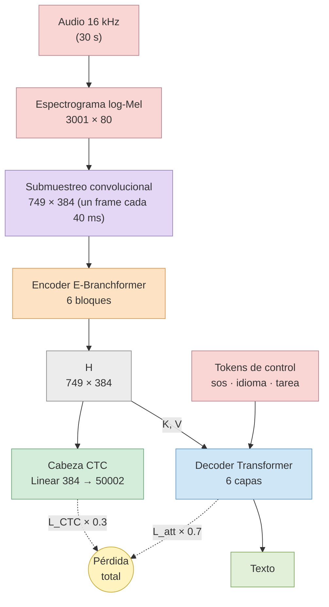

1. **Entrada (3.3):** el audio se ajusta a 30 s y se convierte en un
   espectrograma log-Mel de 3001 frames × 80 bandas de frecuencia.
2. **Submuestreo (3.4):** dos capas convolucionales reducen la secuencia 4
   veces, a 749 frames de 384 dimensiones.
3. **Encoder (3.5):** seis bloques E-Branchformer procesan el audio y producen
   **H**, una representación de 749 × 384 que sigue siendo audio: un vector por
   cada 40 ms.
4. **Cabeza CTC (3.6):** una rama lateral sobre H que solo se usa para calcular
   la pérdida CTC durante el entrenamiento.
5. **Decoder (3.7):** recibe los tokens de control y genera el texto token a
   token, consultando H a través de la *cross-attention*, donde H aporta las
   *keys* (K) y los *values* (V).

En el entrenamiento, el modelo combina las dos pérdidas:
**L = 0.3 · L_CTC + 0.7 · L_att**.

### 3.3 Entrada: espectrograma log-Mel

Un audio de 10 segundos a 16 kHz, en su forma cruda, son 160 000 valores entre
−1 y 1, una representación de la que el modelo no puede extraer información
fácilmente: dos fonemas que para el oído humano son idénticos, separados por
100 ms, tienen valores crudos muy diferentes.

El espectrograma log-Mel corrige esto. Representa cómo cambia la energía de las
frecuencias a lo largo del tiempo, agrupándolas en bandas según una escala que
se aproxima a la percepción auditiva humana. Se obtiene en cinco pasos:

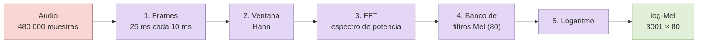

1. **Segmentación en frames.** El audio cambia constantemente, pero en
   intervalos muy cortos se puede considerar estacionario. Se toman ventanas de
   25 ms (400 muestras) que avanzan cada 10 ms (160 muestras), de modo que se
   solapan y no se pierde información en los bordes.

2. **Ventana.** Cortar la señal para formar los frames genera distorsiones
   espectrales en los bordes. Para suavizarlos, cada frame se multiplica por una
   función de ventana; OWSM usa la ventana de Hann:

   $$w(n) = 0.5 - 0.5\cos\left(\frac{2\pi n}{N-1}\right)$$

   Este factor lleva los bordes a cero y mantiene intacta la amplitud del audio
   en la mitad del frame.

3. **Transformada rápida de Fourier (FFT) y espectro de potencia.** Se aplica la
   FFT a cada frame para pasar del dominio del tiempo al dominio de la
   frecuencia, y se calcula su espectro de potencia:

   $$P_i = |\mathrm{FFT}(x_i)|^2$$

   Para la FFT, cada frame de 400 muestras se completa con ceros hasta
   N<sub>FFT</sub> = 512, una potencia de 2.

4. **Banco de filtros Mel.** El oído humano percibe mejor los cambios en
   frecuencias bajas que en altas. Por eso, las frecuencias se agrupan en 80
   bandas siguiendo la escala Mel, que suele definirse como:

   $$m = 2595 \log_{10}\left(1 + \frac{f}{700}\right)$$

   Las bandas son estrechas en los graves y anchas en los agudos, entre 0 y
   8 kHz. ESPnet usa la variante de Slaney de esta escala: lineal por debajo de
   1 kHz y logarítmica por encima.

5. **Logaritmo.** Se aplica el logaritmo a la energía de cada banda, porque el
   oído también percibe la intensidad de forma logarítmica:

   $$\text{log-Mel} = \log(E_{mel} + \varepsilon)$$

   donde ε es un valor muy pequeño que evita calcular log(0).

Para un audio de 30 s, el resultado es una matriz de **3001 × 80**: 3000 frames
(uno cada 10 ms) más uno adicional, porque el primer frame se centra en el
instante 0; y 80 bandas de frecuencia. Finalmente, cada banda se normaliza con
la media y la varianza calculadas sobre todos los datos de entrenamiento.

### 3.4 Submuestreo convolucional

Antes de entrar al encoder, el log-Mel pasa por un bloque de submuestreo que
reduce la longitud de la secuencia y lleva cada frame a la dimensión del modelo
(384 en la versión base):

```mermaid
flowchart LR
    A["log-Mel<br/>1 × 3001 × 80"] --> B["Conv2d 1 → 384<br/>kernel 3, stride 2<br/>+ ReLU"]
    B --> C["384 × 1500 × 39"]
    C --> D["Conv2d 384 → 384<br/>kernel 3, stride 2<br/>+ ReLU"]
    D --> E["384 × 749 × 19"]
    E --> F["Aplanar<br/>749 × 7296"]
    F --> G["Linear<br/>7296 → 384"]
    G --> H["+ Codificación<br/>posicional"]
    H --> I["X<br/>749 × 384"]

    classDef entrada fill:#F9D5D3,stroke:#B5838D,color:#333
    classDef capa fill:#E4D7F5,stroke:#9A86B8,color:#333
    classDef forma fill:#ECECEC,stroke:#8A8A8A,color:#333
    classDef salida fill:#E2F0D9,stroke:#7FA866,color:#333
    class A entrada
    class B,D,G,H capa
    class C,E,F forma
    class I salida
```

1. **El log-Mel como imagen.** El espectrograma se trata como una imagen de un
   solo canal (como una foto en blanco y negro): alto = 3001 (tiempo) y
   ancho = 80 (frecuencia).

2. **Dos capas Conv2d.** En `Conv2d(1 → 384)`, el 1 y el 384 son **canales**:
   la capa tiene 384 filtros de 3 × 3, y cada uno busca un patrón distinto en la
   imagen y produce su propio mapa. Con *stride* 2, cada filtro avanza de dos en
   dos, por lo que cada capa reduce el tiempo y la frecuencia a la mitad:

   $$\text{salida} = \left\lfloor \frac{\text{entrada} - \text{kernel}}{\text{stride}} \right\rfloor + 1$$

   | | Tiempo | Frecuencia |
   |---|---|---|
   | Entrada | 3001 | 80 |
   | Conv2d #1 | ⌊(3001 − 3)/2⌋ + 1 = 1500 | 39 |
   | Conv2d #2 | ⌊(1500 − 3)/2⌋ + 1 = **749** | 19 |

3. **Aplanar y proyectar.** En cada uno de los 749 instantes quedan 384 canales
   × 19 franjas de frecuencia = 7296 valores. Se juntan en un solo vector y una
   capa lineal lo comprime a 384. Desde aquí la frecuencia deja de ser un eje
   separado: queda codificada dentro de los 384 valores de cada frame.

4. **Codificación posicional.** La atención no conoce el orden de los frames, así
   que a cada uno se le suma un vector que indica su posición. Como en el
   entrenamiento tipo Whisper el audio siempre dura 30 s, los autores usan la
   codificación **sinusoidal absoluta** [1], la misma del Transformer original:

   $$PE_{(pos,\,2i)} = \sin\left(\frac{pos}{10000^{2i/d}}\right), \qquad PE_{(pos,\,2i+1)} = \cos\left(\frac{pos}{10000^{2i/d}}\right)$$

   con d = 384. Antes de sumarla, ESPnet multiplica la entrada por √d.

**¿Por qué reducir la secuencia?** La self-attention compara todos los frames
contra todos, por lo que su costo crece con el cuadrado de la longitud. Con 749
frames en lugar de 3001 hay unas 16 veces menos comparaciones. Cada frame pasa
a representar **40 ms** de audio, resolución suficiente para el habla, ya que
un fonema dura entre 50 y 100 ms. Whisper reduce la secuencia solo a la mitad
(20 ms por frame); según los autores, el mayor salto temporal de OWSM v3.1 es
una de las razones de su inferencia más rápida [1].

### 3.5 Encoder E-Branchformer

El encoder está formado por **6 bloques E-Branchformer** iguales [4]. Cada bloque
recibe una secuencia de T × 384 (T = 749) y entrega otra del mismo tamaño. La
idea central es procesar el audio con **dos ramas en paralelo**: una global, que
relaciona frames lejanos, y una local, que captura patrones cercanos en el
tiempo. Los autores eligieron este encoder porque converge más rápido que el
Transformer y el Conformer [1].

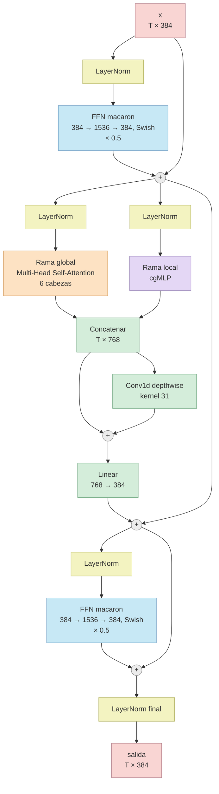

1. **FFN macaron.** En lugar de una sola red *feed-forward* después de la
   atención, hay dos "a la mitad" (multiplicadas por 0.5), una antes y otra
   después de las ramas, como el pan de un sándwich. Esta idea, tomada del
   Conformer, ayuda a mejorar la estabilidad.

2. **Rama global: Multi-Head Self-Attention.** La entrada de esta rama es el
   resultado de la primera FFN macaron (ya sumado a su conexión residual),
   normalizado con LayerNorm. Llamémosla Z (749 × 384). Las *queries* (Q),
   *keys* (K) y *values* (V) se generan a partir de esa misma Z, multiplicándola
   por tres matrices de pesos aprendidas:

   $$Q = ZW_Q, \qquad K = ZW_K, \qquad V = ZW_V$$

   Cada frame compara su *query* con las *keys* de todos los frames; el
   resultado se normaliza con softmax y se usa para ponderar los *values*:

   $$\text{Attention}(Q, K, V) = \text{softmax}\left(\frac{QK^\top}{\sqrt{d_k}}\right)V$$

   La matriz de pesos softmax(QKᵀ/√d<sub>k</sub>) es de 749 × 749: indica
   cuánto mira cada frame a cada uno de los demás. Este cálculo se hace en
   **6 cabezas** en paralelo, cada una con sus propias matrices y
   d<sub>k</sub> = 64 (6 × 64 = 384); sus salidas se concatenan y pasan por una
   capa lineal. Así, cada frame puede mirar los 749 frames del audio y la rama
   captura el contexto de toda la frase.

3. **Rama local: cgMLP** (*Convolutional Gating MLP*). Captura patrones cercanos
   en el tiempo, como fonemas y transiciones entre sonidos:
   - Una capa lineal expande de 384 a 1536 (con GELU) y el resultado se divide
     en dos mitades de 768: x<sub>r</sub> y x<sub>g</sub>.
   - x<sub>g</sub> pasa por una **convolución 1D depthwise** de kernel 31 a lo
     largo del tiempo, es decir, mira 31 frames vecinos (≈1.2 s de audio).
   - x<sub>g</sub> actúa como **compuerta**: se multiplica elemento a elemento
     por la otra mitad (x<sub>r</sub> ⊙ x<sub>g</sub>), decidiendo cuánto deja
     pasar de cada canal según el contexto cercano.
   - Una capa lineal vuelve de 768 a 384.

   La convolución es 1D porque, tras el submuestreo, solo el tiempo tiene
   vecinos (la frecuencia ya está codificada dentro de los 384 valores). Es
   *depthwise* porque cada canal tiene su propio filtro: así necesita unos 24 mil
   parámetros, en lugar de los 18 millones de una convolución completa.

4. **Fusión mejorada.** Las salidas de las dos ramas se concatenan (T × 768), se
   les suma una convolución 1D depthwise que mezcla información de frames
   vecinos entre ambas ramas, y una capa lineal regresa a 384. Esta fusión es la
   mejora del E-Branchformer (*Enhanced*) frente al Branchformer original.

5. **Normalización y conexiones residuales.** Cada componente se normaliza
   *antes* de aplicarse (*pre-LN*) y se suma a su entrada mediante una conexión
   residual: hay tres por bloque (las dos FFN y la fusión de las ramas). El
   bloque termina con una LayerNorm final.

| | Encoder Transformer | Bloque E-Branchformer |
|---|---|---|
| Estructura | MHA → Add & Norm → FFN → Add & Norm | FFN½ → (MHA ∥ cgMLP) → fusión → FFN½ |
| Contexto local | No tiene | Convolución depthwise (≈1.2 s) |
| Normalización | Después de sumar (*post-LN*) | Antes de cada componente (*pre-LN*) |
| Conexiones residuales | 2 por bloque | 3 por bloque |

Después de los 6 bloques y una LayerNorm, la salida del encoder es **H**, de
749 × 384: una representación del audio con un vector por cada 40 ms, que pasa a
la cabeza CTC y al decoder.

### 3.6 Cabeza CTC y pérdida conjunta

OWSM entrena con un mecanismo híbrido, incorporado en OWSM [3] y heredado por
la v3.1: combina la pérdida de **clasificación temporal conexionista** (CTC,
*Connectionist Temporal Classification*) sobre el encoder con la pérdida de
entropía cruzada del decoder basado en atención.

**El problema que resuelve CTC.** Tenemos muchos frames de audio y pocos tokens
de texto: 1 s de audio son 25 frames del encoder, mientras que la palabra "hola"
son apenas unos pocos tokens. Para entrenar haría falta saber qué frame
corresponde a qué token (por ejemplo, que la "h" está en los frames 3 a 5), pero
los datos de entrenamiento no traen ese detalle: solo traen el audio y su
transcripción completa.

**La cabeza CTC.** Es una sola capa lineal aplicada a cada frame de H por separado:

```
H (749 × 384)  →  Linear 384 → 50002  →  softmax  →  749 × 50002
```

Para cada frame de 40 ms predice un símbolo entre los ≈50 mil tokens del
vocabulario, más un símbolo especial **_ (blank)**, que significa "aquí no se
emite nada nuevo". La predicción se convierte en texto juntando los símbolos
repetidos consecutivos y borrando los blanks:

```
frames:      1  2  3  4  5  6  7  8  9  10
predicción:  _  h  h  o  _  _  l  a  a  _
resultado:   "hola"
```

**La pérdida CTC.** Hay muchas predicciones posibles (caminos) que, tras aplicar
esta regla, dan el texto correcto. CTC no necesita saber cuál es la verdadera:
**suma la probabilidad de todos los caminos** que producen la transcripción y maximiza esa suma:

$$P(y \mid x) = \sum_{\pi \,\to\, y} \; \prod_{t=1}^{T} p_t(\pi_t), \qquad \mathcal{L}_{CTC} = -\log P(y \mid x)$$

donde π es un camino, con un símbolo por frame. La suma sobre todos los caminos
se calcula eficientemente con programación dinámica. El texto de referencia se
convierte en índices de tokens con el mismo tokenizador del modelo (por ejemplo,
"hola cómo estás" → `[13944, 1721, 18111, 5818, 1687]`), y esos índices indican
qué columnas de la salida 749 × 50002 se leen en cada frame.

Por su regla de colapso, CTC fuerza un **orden monótono**: el texto avanza en el
mismo orden que el audio, lo que es ideal para la transcripción. Esto obliga al
encoder a producir representaciones bien alineadas en el tiempo.

**Una rama lateral.** H no se transforma en texto antes de llegar al decoder: se
copia completo (749 × 384) hacia dos destinos independientes, la cabeza CTC y la
*cross-attention* del decoder. Las dos ramas no se pasan información; se
relacionan a través de la pérdida total:

$$\mathcal{L} = \lambda_1 \, \mathcal{L}_{CTC} + \lambda_2 \, \mathcal{L}_{att}, \qquad \lambda_1 + \lambda_2 = 1$$

Para OWSM v3.1, λ<sub>1</sub> = 0.3 y λ<sub>2</sub> = 0.7 (valor `ctc_weight: 0.3`
en la configuración publicada del modelo). En la retropropagación, los gradientes
de ambas pérdidas se suman en el encoder compartido: así, CTC organiza el
encoder y el decoder se beneficia al consultar un H mejor alineado. Según los
autores, esta pérdida conjunta ayuda a estabilizar y acelerar la convergencia [3].

### 3.7 Decoder Transformer

El decoder es la parte del modelo que **escribe**. El cambio principal de
OWSM v3.1 está en el encoder; el decoder sigue siendo un Transformer estándar,
del mismo tipo que el de OWSM v3 y Whisper, aunque con menos capas que el de
OWSM v3 (en el tamaño medium, 18 frente a 24) [1]. Funciona como un **modelo de lenguaje condicionado al audio** [2]: predice
el siguiente token a partir de los tokens que ya escribió y de la memoria
acústica H. Recibe dos entradas: los tokens generados hasta el momento (al
inicio, solo el *prompt* de control, sección 3.8) y H (749 × 384), que viene del
encoder y no cambia durante toda la generación. En el modelo base tiene 6 capas
iguales, de dimensión 384 y con 6 cabezas de atención [1].

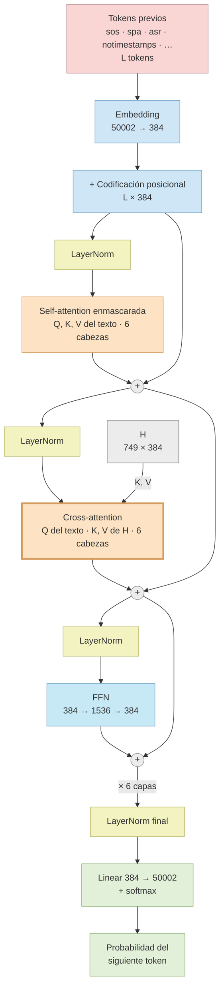

1. **Embedding.** Cada token es un número entero (su ID). El embedding es una
   tabla aprendida de 50 002 × 384: convertir un token en vector es simplemente
   tomar la fila correspondiente. Por ejemplo, el *prompt* `[49999, 121, 155, 181]`
   se convierte en una matriz de 4 × 384. Así el texto queda con la misma
   dimensión que H, y el decoder puede compararlos.

2. **Codificación posicional.** Igual que en el encoder (sección 3.4), la
   atención no conoce el orden de los tokens, así que a cada vector se le suma
   la codificación posicional sinusoidal de su posición (implementación del
   decoder en ESPnet [5]). Whisper, en cambio, usa posiciones aprendidas en el decoder [2].

3. **Self-attention enmascarada.** Llamemos S a los vectores del texto
   (L × 384, con L el número de tokens). Las *queries*, *keys* y *values* se
   generan **del mismo texto**, con la misma fórmula de la sección 3.5, pero con
   una máscara causal M que se suma antes del softmax:

   $$\text{MaskedAttention}(Q, K, V) = \text{softmax}\left(\frac{QK^\top}{\sqrt{d_k}} + M\right)V, \qquad M_{ij} = \begin{cases} 0 & j \le i \\ -\infty & j > i \end{cases}$$

   donde Q = SW<sub>Q</sub>, K = SW<sub>K</sub> y V = SW<sub>V</sub>. Como
   e<sup>−∞</sup> = 0, el token *i* solo puede mirar los tokens 1 a *i*: nunca
   el futuro. El mapa de atención es de L × L. Esta capa le dice a cada token
   **qué se ha escrito antes**: el contexto del lenguaje (después de "cómo" es
   probable "está").

4. **Cross-attention.** Es el **único punto donde el texto consulta el audio**.
   Las *queries* salen del texto y las *keys* y *values* salen de H:

   $$Q = S\,W_Q \;\; (L \times 384), \qquad K = H\,W_K \;\; (749 \times 384), \qquad V = H\,W_V \;\; (749 \times 384)$$

   $$A = \text{softmax}\left(\frac{QK^\top}{\sqrt{d_k}}\right) \;\; (L \times 749), \qquad \text{salida} = AV \;\; (L \times 384)$$

   donde S son los estados del decoder después de la *self-attention*. Cada
   token pregunta (Q): "según lo que llevo escrito, ¿qué parte del audio necesito
   para el siguiente?". Cada frame de 40 ms responde con su clave (K), y el
   resultado mezcla la información acústica (V) de los frames elegidos. La fila
   *i* de A es una distribución sobre los 749 frames: una **alineación suave**
   entre texto y audio, que se calcula de nuevo en cada paso y no lleva máscara.
   H es la misma en las 6 capas, pero cada capa y cada cabeza (d<sub>k</sub> =
   64) tienen sus propias W<sub>Q</sub>, W<sub>K</sub> y W<sub>V</sub>, así que
   cada una consulta el audio de forma distinta. Estos 6 × 6 mapas son los que
   visualiza nuestra aplicación (sección 5.7).

5. **FFN.** Dos capas lineales con una activación en medio, aplicadas a cada
   token por separado: 384 → 1536 → 384 (configuración publicada del modelo),
   con activación ReLU (implementación de ESPnet [5]). Las atenciones **mezclan** información entre posiciones; la FFN
   **procesa** lo que cada token recibió del texto y del audio. A diferencia del
   encoder, es una FFN completa y no dos medias.

6. **Normalización y conexiones residuales.** Como en el encoder, cada
   subcapa se normaliza antes de aplicarse (*pre-LN*, implementación de ESPnet
   [5]) y su salida se suma a su entrada: hay 3 conexiones residuales por capa, una por subcapa.

7. **Capa de salida.** Después de las 6 capas y una LayerNorm final, una capa
   lineal convierte el vector de cada token en 50 002 puntajes (*logits*), uno
   por token del vocabulario, y un softmax los vuelve probabilidades. Durante la
   generación solo se usa la última fila: la probabilidad del **siguiente**
   token. En OWSM esta capa no comparte pesos con el embedding de entrada [3];
   en Whisper sí [2].

En el entrenamiento, el decoder recibe la transcripción correcta completa y
predice todas las posiciones a la vez (*teacher forcing*). Su pérdida es la
entropía cruzada entre la predicción y el token correcto en cada posición:

$$P(y \mid X) = \prod_{i=1}^{N} p\left(y_i \mid y_{<i},\, H\right), \qquad \mathcal{L}_{att} = -\sum_{i=1}^{N} \log p\left(y_i \mid y_{<i},\, H\right)$$

donde y<sub><i</sub> son los tokens anteriores a *i* y N es la longitud del
texto. Esta es la L<sub>att</sub> que pesa 0.7 en la pérdida total (sección
3.6).

**¿Por qué la máscara?** Con *teacher forcing*, el decoder ve toda la frase
correcta. Sin máscara, para predecir el token 5 le bastaría con mirar el token 5
de su entrada: aprendería a copiar. La máscara hace que el entrenamiento se
comporte igual que la inferencia, donde el futuro todavía no existe. Por esta
misma razón, nuestra aplicación puede recalcular la atención de la frase
completa en una sola pasada (sección 5.7).

**¿Por qué un decoder pequeño?** El encoder se ejecuta una sola vez por audio,
pero el decoder se ejecuta una vez **por cada token** generado. Según los
autores, OWSM v3.1 es hasta un 25 % más rápido que OWSM v3 en inferencia
principalmente por su decoder más pequeño, además del paso de 40 ms del encoder
[1].

| | Bloque del encoder (E-Branchformer) | Capa del decoder (Transformer) |
|---|---|---|
| Atenciones | 1: *self-attention* sin máscara | 2: *self-attention* **enmascarada** y *cross-attention* |
| Contexto local | Convolución (cgMLP, kernel 31) | No tiene |
| FFN | Dos medias (macaron) | Una completa |
| Q, K, V | Del audio | *Self*: del texto · *Cross*: Q del texto, K y V de H |
| Ejecuciones | 1 por audio | 1 por cada token |

### 3.8 Tokens especiales y formato multitarea

Whisper [2] introdujo la idea de que **un solo modelo** haga varias tareas:
transcribir, traducir, identificar el idioma y marcar tiempos. La tarea no se
elige cambiando el modelo, sino **escribiéndola** al inicio del texto con tokens
especiales. OWSM [3] reproduce este formato y lo extiende. El decoder recibe
estos tokens como cualquier otro texto, y a partir de ellos genera la salida.

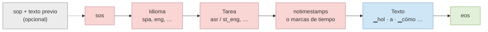

1. **Texto previo (opcional).** El token `<sop>` seguido del texto de la
   oración anterior da contexto al decoder [3]. En el entrenamiento de OWSM v3.1
   se incluye con una probabilidad de 0.5 [1]. Nuestra aplicación no lo usa (ver
   el porqué al final de esta sección).

2. **Inicio (`<sos>`).** Marca dónde empieza la salida del decoder [3].

3. **Idioma.** Un token por idioma del audio, como `<spa>` o `<eng>`; OWSM
   cubre 151 idiomas, frente a los 99 de Whisper [3]. Si no se le da, el modelo
   lo predice como primer token, y eso es exactamente la **identificación de
   idioma** [3].

4. **Tarea.** `<asr>` para transcribir en el mismo idioma, o un token de
   traducción **por cada idioma destino**, como `<st_eng>` o `<st_spa>`. Por
   eso OWSM puede traducir entre distintos pares de idiomas, mientras que
   Whisper solo traduce hacia el inglés [2], [3].

5. **Marcas de tiempo.** `<notimestamps>` pide solo texto. Sin ese token, el
   modelo intercala tokens de tiempo con una resolución de 20 ms que indican
   dónde empieza y termina cada segmento [2], [3].

6. **Texto y fin (`<eos>`).** El decoder genera el texto como subpalabras de
   SentencePiece [6] y termina con `<eos>`.

Todo, incluidos los tokens de control, se predice de forma autorregresiva con
el mismo decoder [3]. Durante la inferencia nosotros escribimos el *prompt* y el
modelo continúa desde ahí:

$$p(y \mid X) = \prod_{i=1}^{N} p\left(y_i \mid \underbrace{\texttt{<sos>}, \texttt{<spa>}, \texttt{<asr>}, \texttt{<notimestamps>}}_{\text{prompt}},\; y_{<i},\; H\right)$$

Los IDs concretos de cada token y cómo se construye el *prompt* en nuestro
código están en la sección 5.5.

**¿Por qué tokens y no un modelo por tarea?** Los tokens de control entran por
la *self-attention* enmascarada como cualquier otro token, así que **todo** lo
que el decoder escribe después los "ve" y queda condicionado por ellos. Con los
mismos pesos, `<asr>` produce una transcripción y `<st_eng>`, una traducción.
Las tareas comparten lo aprendido y basta un solo modelo.

**¿Por qué fijamos el idioma y no usamos texto previo?** En el modelo base, la
identificación de idioma solo acierta el 41.9 % de las veces [1], por eso
nuestra aplicación pide el idioma al usuario y lo escribe en el *prompt*. El
texto previo sirve para transcribir audios largos por segmentos, pasando la
oración anterior como contexto; nuestra aplicación procesa un solo segmento de
hasta 30 s, así que no hay contexto que dar. El mismo espacio del *prompt*
también puede usarse para dar una lista de palabras difíciles (*contextual
biasing*): en small y medium mejora mucho el reconocimiento de esas palabras
sin empeorar el resto, mientras que en el base apenas las mejora y empeora
las demás. Los autores lo describen como una **habilidad emergente**, que aparece con el
tamaño del modelo [1].

### 3.9 Inferencia

El modelo **no produce texto directamente**: en cada paso produce una
distribución de probabilidad sobre los 50 002 tokens del vocabulario. El texto
final es el resultado de un **algoritmo de búsqueda** que usa esas
distribuciones para elegir token a token, más una **detokenización** que une
los tokens en palabras. Esta sección explica la teoría; la configuración que
usamos está en la sección 4.4 y su implementación en la sección 5.6.

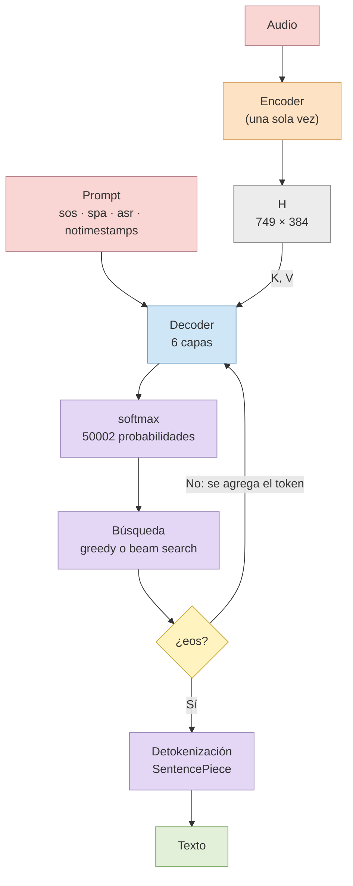

1. **Generación autorregresiva.** El encoder se ejecuta una sola vez y produce
   H. El decoder, en cambio, genera un token por paso: el token elegido se
   agrega a su entrada y se vuelve a ejecutar para predecir el siguiente, hasta
   que aparece `<eos>`. Para "hola cómo estás" (`▁hol`, `a`, `▁cómo`, `▁está`,
   `s`, `<eos>`), el decoder se ejecuta 6 veces.

2. **Búsqueda *greedy*.** La opción más simple es tomar siempre el token más
   probable. Es rápida, pero un error temprano ya no se corrige, porque cada
   token condiciona a todos los siguientes. Los resultados de reconocimiento de
   voz del artículo se reportan con esta búsqueda [1].

3. ***Beam search*.** En vez de una sola secuencia, mantiene las *k* secuencias
   parciales más probables. En cada paso extiende cada una con sus mejores
   candidatos y conserva solo las *k* mejores del total. El puntaje de una
   hipótesis es la suma de las log-probabilidades de sus tokens:

   $$\text{score}(y_{1:i}) = \sum_{j=1}^{i} \log p\left(y_j \mid y_{<j},\, H\right)$$

   donde se usan logaritmos para sumar en vez de multiplicar probabilidades muy
   pequeñas. Whisper usa *k* = 5 porque reduce los bucles de repetición [2], y
   en OWSM v3 el *beam search* mejora el reconocimiento de audio largo frente a
   *greedy* [3]. Nuestra aplicación usa *k* = 5 (sección 4.4).

4. **CTC en la decodificación.** El modelo tiene una segunda salida sobre H: la
   cabeza CTC (sección 3.6). En la búsqueda, su opinión puede combinarse con la
   del decoder mediante un peso λ (fórmula en la sección 4.4). La cabeza CTC
   lee el audio en orden y sin volver atrás, así que penaliza las hipótesis que
   no siguen el audio, como repeticiones u omisiones. Los autores de OWSM
   comparan tres opciones en reconocimiento de voz: solo CTC da los peores
   resultados, solo el decoder es mejor, y la combinación de ambos con *beam
   search* es la mejor; que el decoder solo supere a CTC solo indica que el
   decoder tiene mucha capacidad [3]. La combinación solo aplica al
   reconocimiento, porque la CTC se entrenó únicamente con transcripciones [3]:
   en una traducción el orden de las palabras no sigue al audio.

5. **Fin de la búsqueda.** Una hipótesis termina cuando genera `<eos>`. Se
   devuelve la hipótesis terminada con mayor puntaje.

6. **Detokenización y salida final.** De la secuencia ganadora se quitan el
   *prompt* y `<eos>`, los IDs se convierten en tokens y el tokenizador
   SentencePiece [6] los une en texto: el símbolo `▁` marca el inicio de una
   palabra y se reemplaza por un espacio. Así,
   `['▁hol', 'a', '▁cómo', '▁está', 's']` se convierte en "hola cómo estás"
   (detalle en la sección 5.6).

**¿Por qué no usar siempre la opción más robusta?** Cada mejora cuesta tiempo:
el *beam search* ejecuta el decoder para *k* hipótesis a la vez, y la
combinación con CTC añade el cálculo de la cabeza CTC en cada paso. Nosotros
usamos *beam search* con *k* = 5, pero sin CTC (λ = 0), para que cada token lo
decida únicamente el decoder y el mapa de *cross-attention* explique toda la
salida (sección 4.4).

| | Entrenamiento | Inferencia |
|---|---|---|
| Entrada del decoder | La transcripción correcta completa (*teacher forcing*) | El *prompt* más sus propias predicciones |
| Pasadas del decoder | Una, todas las posiciones a la vez | Una por cada token generado |
| Máscara causal | Evita mirar los tokens correctos futuros | Se mantiene; el futuro aún no existe |
| Objetivo | Minimizar 0.3 · L<sub>CTC</sub> + 0.7 · L<sub>att</sub> | Encontrar la secuencia con mejor puntaje |
| Papel de CTC | Pérdida auxiliar que alinea H en el tiempo | Opcional, con peso λ (λ = 0 en nuestra aplicación) |
| Errores | No se propagan: siempre ve el prefijo correcto | Un error temprano afecta a todo lo que sigue |

---

## 4. Metodología

Este proyecto no entrena el modelo: usa los pesos publicados por los autores y
se concentra en implementar la inferencia, inspeccionar el mecanismo de atención
y presentarlo en una interfaz interactiva. Esta sección describe cómo se
organizó el trabajo, qué herramientas se usaron y qué decisiones se tomaron
sobre los pesos y la decodificación. La sección 5 muestra cómo esas decisiones
se convierten en código.

### 4.1 Proceso de implementación

El trabajo se organizó en siete fases. Cada una se apoya en la anterior: primero
se comprobó que el modelo funciona en nuestro hardware y solo después se
construyó encima.


1. **Selección del artículo.** Se buscó un Transformer encoder–decoder para
   datos secuenciales que tuviera artículo reciente, código y pesos públicos.
   OWSM v3.1 [1] cumple las tres condiciones: el artículo es de 2024, el código
   está en ESPnet [5] y los pesos están en Hugging Face.

2. **Estudio de la arquitectura.** Se leyó el artículo junto con el
   `config.yaml` del modelo publicado, que describe capa por capa la red que se
   ejecuta. De ahí salen las dimensiones de la sección 3 (3001 × 80, 749 × 384,
   6 bloques, 6 cabezas).

3. **Prueba mínima por consola** (`scripts/prueba_inferencia.py`). Antes de
   escribir la interfaz se verificó que el modelo se descarga, carga y transcribe
   un audio en un computador sin GPU. Se midieron el número de parámetros, el
   tiempo de carga, el tiempo de inferencia y la memoria RAM.

4. **Extracción de la cross-attention** (`owsm_demo/atencion.py`). ESPnet
   devuelve el texto, pero no los pesos de atención. Se implementó una segunda
   pasada por el decoder para recuperar la matriz softmax(QKᵀ/√d<sub>k</sub>) de
   las 6 capas y las 6 cabezas (sección 5.7).

5. **Visualización** (`owsm_demo/graficos.py`). Se dibujan el log-Mel de entrada
   y el mapa de atención con el mismo eje de tiempo, para ver qué parte del
   audio usó el decoder al generar cada token.

6. **Interfaz interactiva** (`app.py`). Una aplicación en Streamlit permite
   grabar o subir un audio, elegir idioma y tarea, ejecutar la inferencia y
   explorar la atención por capa y por cabeza.

7. **Pruebas y análisis.** Se ejecutaron audios propios en distintos idiomas y
   tareas para obtener los resultados de la sección 6.

### 4.2 Herramientas utilizadas

| Herramienta | Versión | Uso en el proyecto |
|---|---|---|
| Python | 3.12 | Lenguaje del proyecto (`.python-version`). |
| [uv](https://docs.astral.sh/uv/) | — | Gestor del entorno y las dependencias. El archivo `uv.lock` fija la versión exacta de cada paquete, así el entorno es idéntico en cualquier computador. |
| PyTorch / torchaudio | 2.12 / 2.11 | Motor de tensores sobre el que corre la red, en CPU o GPU. |
| ESPnet [5] | 202611 | *Toolkit* con el que los autores entrenaron OWSM. Su clase `Speech2Text` construye la red desde `config.yaml`, carga los pesos y ejecuta el *beam search*. |
| espnet_model_zoo / Hugging Face Hub | 0.1.7 / 2.4 | Descarga de los pesos preentrenados y del resto de archivos del modelo. |
| librosa / soundfile | 0.11 / 0.14 | Lectura de audio (wav, mp3, flac, ogg), conversión a mono y remuestreo a 16 kHz. |
| matplotlib | 3.11 | Gráficos del log-Mel y de los mapas de atención. |
| Streamlit | 1.67 | Interfaz web interactiva. |
| psutil | 7.2 | Medición de la RAM usada en la prueba por consola. |

### 4.3 Uso de pesos preentrenados

No se entrena ni se ajusta (*fine-tuning*) el modelo. Reproducir el
entrenamiento requiere 180 mil horas de audio y un clúster de GPUs [1], lo que
está fuera del alcance del proyecto y de su objetivo: entender la arquitectura e
implementar su inferencia.

**Qué publican los autores.** El repositorio
[`espnet/owsm_v3.1_ebf_base`](https://huggingface.co/espnet/owsm_v3.1_ebf_base)
contiene todo lo necesario para reconstruir el modelo exactamente como se
entrenó:

| Archivo | Contenido |
|---|---|
| `config.yaml` | Descripción completa de la red (tipo de encoder y decoder, capas, dimensiones, cabezas), la configuración del log-Mel (`n_fft: 512`, `win_length: 400`, `hop_length: 160`), el preprocesador (ventana de 30 s) y la lista de los **50 002 tokens** del vocabulario. |
| `valid.total_count.ave_5best.pth` | Los pesos (≈405 MB). El nombre indica que son el **promedio de los 5 mejores checkpoints** según el conjunto de validación, una técnica que suele dar un modelo más estable que el último checkpoint. |
| `bpe.model` | Tokenizador SentencePiece [6] de tipo *unigram* con 50 000 subpalabras. Convierte texto en tokens y tokens en texto. |
| `feats_stats.npz` | Media y varianza de cada banda del log-Mel sobre los datos de entrenamiento, usadas en la normalización (sección 3.3). |
| `meta.yaml` | Versiones con que se entrenó el modelo (ESPnet 202308, PyTorch 1.13.1) y la ruta de cada archivo. |

**Elección del tamaño.** OWSM v3.1 se publicó en tres tamaños. Los tres
comparten la misma arquitectura (sección 3.2): solo cambian el ancho y la
profundidad.

| Modelo | Parámetros | Dimensión d | Bloques del encoder | Capas del decoder |
|---|---|---|---|---|
| **base** (usado) | 101M | 384 | 6 | 6 |
| small | 367M | 768 | 9 | 9 |
| medium | 1.02B | 1024 | 18 | 18 |

Se eligió el modelo **base** por tres razones: corre en CPU sin GPU, ocupa unos
400 MB y responde en pocos segundos, algo necesario para una demostración en
vivo. El costo es una menor precisión que la de los modelos más grandes [1]. Como
la arquitectura es la misma, todo lo explicado en la sección 3 aplica igual a
los tres tamaños.

### 4.4 Configuración de la decodificación

Como se vio en la sección 3.6, el modelo tiene dos salidas sobre H: la cabeza CTC
y el decoder. En inferencia, ESPnet puede usarlas por separado o combinarlas. Para
cada hipótesis de texto *y* calcula un puntaje:

$$\text{score}(y) = (1 - \lambda)\,\log p_{att}(y \mid H) + \lambda\,\log p_{CTC}(y \mid H)$$

| λ (`ctc_weight`) | Búsqueda | Quién decide el texto |
|---|---|---|
| **0** (usado) | Beam search de atención | Solo el decoder |
| 0 < λ < 1 | Beam search híbrido | Decoder y CTC |
| 1 | Beam search CTC | Solo la cabeza CTC |

El `ctc_weight` de la inferencia no es el mismo que el del entrenamiento. En el
entrenamiento (0.3) pondera las **pérdidas**; en la inferencia pondera los
**puntajes** de las hipótesis. Comparten el nombre, pero son independientes.

**¿Por qué λ = 0?** El objetivo es analizar la *cross-attention* del decoder. Con
λ = 0, cada token del texto lo elige únicamente el decoder, que consulta H a
través de esa atención. Así, el mapa de atención de la sección 5.7 explica por
completo la salida. Con λ > 0, parte de la decisión vendría de la cabeza CTC, que
no usa esa atención. El costo es que la decodificación híbrida suele ser algo más
robusta frente a repeticiones u omisiones.

Los demás parámetros de la decodificación son:

| Parámetro | Valor | Significado |
|---|---|---|
| `beam_size` | 5 | Número de hipótesis que se mantienen en cada paso del beam search (sección 5.6). |
| `ctc_weight` | 0.0 | Decodificación solo con el decoder. |
| `maxlenratio` | 0.0 | Longitud máxima de la salida igual a la longitud de H (749 tokens). La búsqueda se detiene antes, cuando las hipótesis terminan en `<eos>`. |
| `penalty` | 0.0 | Sin bonificación ni castigo por longitud. |
| `nbest` | 1 | Solo se devuelve la mejor hipótesis. |
| `lang_sym` / `task_sym` | `<spa>` / `<asr>` | Idioma y tarea por defecto. La interfaz los cambia en cada inferencia (sección 5.5). |
| `predict_time` | `False` | Sin marcas de tiempo, salvo que el usuario las active. |
| `device` | automático | `cuda` si hay GPU, si no `cpu`. |

### 4.5 Entrenamiento de los autores (referencia)

Este proyecto no entrena, pero los datos del entrenamiento publicado [1] ayudan a
interpretar el comportamiento del modelo base:

| Dato | Valor (modelo base) |
|---|---|
| Datos | 180 mil horas de audio de corpus públicos (las mismas que OWSM v3) |
| Pasadas | ≈ 3 sobre el conjunto completo |
| Tamaño de lote | 256 |
| Hardware | 16 GPU NVIDIA A100 de 40 GB |
| Costo estimado | ≈ 2.3 mil horas-GPU (small: 3.2 mil; medium: 24.6 mil) |
| Tasa de aprendizaje máxima | 1e-3 (small: 5e-4; medium: 2e-4) |
| Calendario | Subida lineal por tramos y luego decaimiento exponencial |
| Pérdida | 0.3 · CTC + 0.7 · atención (sección 3.6) |

Estos valores muestran por qué no se reproduce el entrenamiento (sección 4.3) y
cuánto menos recursos usa OWSM que Whisper, que se entrenó con unas 680 mil horas.

---

## 5. Desarrollo e implementación

Esta sección recorre el código en el mismo orden en que viaja la información:
cómo ejecutar el proyecto, cómo se cargan los pesos, cómo se prepara el audio,
cómo se genera el texto, cómo se extrae la atención y cómo se muestra todo en la
interfaz.

### 5.1 Estructura del repositorio

```
owsm-ebranchformer-v31/
├── pyproject.toml            # dependencias del proyecto
├── uv.lock                   # versiones exactas (entorno reproducible)
├── .python-version           # Python 3.12
├── app.py                    # interfaz Streamlit
├── owsm_demo/
│   ├── modelo.py             # caché, carga del modelo, lectura de audio, transcripción
│   ├── atencion.py           # inferencia + extracción de la cross-attention
│   └── graficos.py           # log-Mel y mapas de calor de atención
├── scripts/
│   └── prueba_inferencia.py  # prueba por consola con tiempo y RAM
└── docs/                     # documentación de apoyo
```

| Módulo | Responsabilidad |
|---|---|
| `owsm_demo/modelo.py` | Configura el caché, carga `Speech2Text` con los parámetros de la sección 4.4, lee el audio y lo convierte a 16 kHz mono. |
| `owsm_demo/atencion.py` | Ejecuta la inferencia y extrae los pesos de *cross-attention*, el log-Mel y la probabilidad de cada token. |
| `owsm_demo/graficos.py` | Dibuja el log-Mel y el mapa de atención con el mismo eje de tiempo, y la comparación entre cabezas. |
| `app.py` | Interfaz: entrada de audio, configuración, ejecución, salidas y visualización. |

### 5.2 Pasos para ejecutar el proyecto

**Requisitos:** [uv](https://docs.astral.sh/uv/) instalado, conexión a internet
la primera vez, unos 400 MB de disco para el modelo y 1.5 GB de RAM libre. No
requiere GPU.

```bash
# 1. Clonar el repositorio
git clone https://github.com/sebasjp/owsm-ebranchformer-v31
cd owsm-ebranchformer-v31

# 2. Crear el entorno e instalar las dependencias (lee pyproject.toml y uv.lock)
uv sync

# 3. Ejecutar la interfaz (se abre en http://localhost:8501)
uv run streamlit run app.py
```

También se puede probar el modelo sin interfaz:

```bash
uv run python scripts/prueba_inferencia.py ruta/al/audio.wav --idioma "<spa>" --tarea "<asr>"
```

Este script imprime el dispositivo, el número de parámetros, el tiempo de carga,
el tiempo de inferencia, la RAM usada, los tokens generados y el texto.

La primera ejecución descarga el modelo desde Hugging Face. Las siguientes lo
leen del caché local.

### 5.3 Carga de los pesos preentrenados

Toda la carga ocurre en una sola llamada de `owsm_demo/modelo.py`:

```python
MODELO_HF = "espnet/owsm_v3.1_ebf_base"

Speech2Text.from_pretrained(
    MODELO_HF,
    device=dispositivo(),     # "cuda" si hay GPU, si no "cpu"
    beam_size=5,
    ctc_weight=0.0,
    maxlenratio=0.0,
    lang_sym="<spa>",
    task_sym="<asr>",
    predict_time=False,
)
```

Internamente, esa llamada sigue estos pasos:

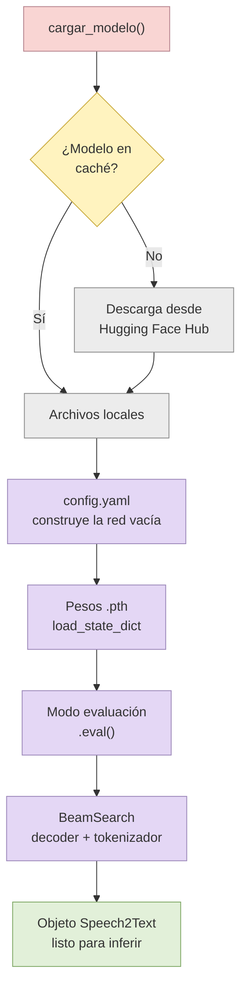

1. **Descarga.** `from_pretrained` usa `espnet_model_zoo` para bajar el
   repositorio del modelo desde Hugging Face Hub (los archivos de la sección
   4.3). Si ya están en el caché, no se descarga nada.

2. **Construcción de la red.** ESPnet lee `config.yaml` e instancia cada
   componente con sus hiperparámetros: el frontend log-Mel (3.3), la
   normalización con `feats_stats.npz`, el submuestreo Conv2d (3.4), los 6
   bloques E-Branchformer (3.5), la cabeza CTC (3.6) y el decoder de 6 capas
   (3.7). En este punto la red existe, pero sus pesos son aleatorios.

3. **Carga de los pesos.** El archivo `.pth` es un diccionario que asocia el
   nombre de cada parámetro con su tensor (por ejemplo,
   `encoder.encoders.0.attn.linear_q.weight` → 384 × 384). `load_state_dict`
   copia cada tensor en la capa correspondiente. Si la arquitectura no
   coincidiera con los pesos, este paso fallaría.

4. **Modo evaluación.** `.eval()` desactiva el *dropout* (0.05 en el
   entrenamiento) y SpecAugment, que solo se usan para regularizar durante el
   entrenamiento. Así, el mismo audio produce siempre el mismo resultado.

5. **Preparación de la búsqueda.** Se crea el objeto `BeamSearch` con el decoder
   como único evaluador (λ = 0), el tokenizador `bpe.model` y el conversor entre
   tokens e identificadores.

**Caché del modelo.** En Linux y Colab se usa el caché por defecto de Hugging Face
(`~/.cache/huggingface`). En Windows, `modelo.py` lo ubica en la raíz de la
unidad (por ejemplo, `C:\hf_cache`), porque los nombres de los archivos del modelo
son tan largos que, dentro de la carpeta del proyecto, superan el límite de 260
caracteres de las rutas de Windows. Por eso la variable `HF_HOME` se define antes
de importar ESPnet. Si el usuario ya la definió, se respeta.

**Una sola carga por servidor.** Streamlit vuelve a ejecutar `app.py` completo en
cada interacción. Para no recargar el modelo cada vez, la función que lo carga
está decorada con `@st.cache_resource`: el modelo se construye en la primera
inferencia y después se reutiliza.

### 5.4 Preprocesamiento del audio

El preprocesamiento se reparte entre nuestro código y el modelo. Nuestro código
solo entrega la forma de onda en el formato correcto; el resto lo hace el modelo
con la configuración de `config.yaml`. Así se garantiza que el audio se procese
igual que durante el entrenamiento.


En azul, los pasos de nuestro código (`cargar_audio`); en morado, los que hace
ESPnet dentro de `Speech2Text`.

1. **Lectura, mono y 16 kHz.** `librosa.load(archivo, sr=16000, mono=True)` lee
   cualquier formato soportado, promedia los canales si el audio es estéreo y lo
   remuestrea a 16 kHz. El remuestreo es necesario porque el banco de filtros
   Mel (3.3) se calculó para 16 kHz: con otra frecuencia, cada banda
   correspondería a frecuencias distintas de las aprendidas.

2. **Tipo de dato.** La señal se convierte a `float32`, con valores entre −1 y 1,
   que es el tipo que esperan los pesos del modelo.

3. **Relleno o recorte a 30 s.** `_pad_or_trim` ajusta la señal a exactamente
   16 000 × 30 = **480 000 muestras**: si es más corta, completa con ceros
   (silencio); si es más larga, corta lo que sobra. La interfaz avisa cuando el
   audio supera los 30 s, porque solo se procesan los primeros 30.

4. **log-Mel, normalización y submuestreo.** Dentro de `s2t_model.encode` se
   aplican los pasos de las secciones 3.3 y 3.4: espectrograma log-Mel de
   3001 × 80, normalización de cada banda con la media y la varianza de
   `feats_stats.npz` (`global_mvn`) y submuestreo convolucional a 749 × 384.

| Etapa | Forma | Resolución temporal |
|---|---|---|
| Forma de onda | 480 000 | 1/16 000 s por muestra |
| log-Mel | 3001 × 80 | 10 ms por frame |
| Después del submuestreo | 749 × 384 | 40 ms por frame |
| H (salida del encoder) | 749 × 384 | 40 ms por frame |

**¿Por qué rellenar con silencio?** El modelo se entrenó siempre con ventanas de
30 s, con el mismo esquema de Whisper [2]. La codificación posicional
sinusoidal (3.4) y la atención aprendieron a trabajar con 749 posiciones; darle
siempre la misma longitud evita que el modelo vea entradas distintas de las del
entrenamiento.

### 5.5 Prompt de control del decoder

El decoder no empieza a generar desde cero: recibe primero una secuencia de
tokens especiales, el *prompt*, que le indica qué hacer. Es el mismo mecanismo de
Whisper (sección 3.1). `Speech2Text._build_hyp_primer` lo construye así:

```
<sos> <idioma> <tarea> [<notimestamps>]
```

| Token | ID | Función |
|---|---|---|
| `<sos>` | 49999 | Inicio de la secuencia. |
| `<spa>` | 121 | Idioma del audio (151 idiomas posibles; `<eng>` = 31). |
| `<asr>` | 155 | Tarea: transcribir en el mismo idioma. `<st_eng>` (161) traduce al inglés, y así para cada idioma destino. |
| `<notimestamps>` | 181 | Pide texto sin marcas de tiempo. |
| `<eos>` | 50000 | Fin de la secuencia. Lo genera el modelo, no forma parte del prompt. |

Los identificadores salen de la lista de tokens del `config.yaml`: el índice de
cada token en esa lista es su ID.

Con la configuración por defecto, el prompt es `[49999, 121, 155, 181]`.
El **mismo modelo, con los mismos pesos**, transcribe o traduce según el token de
tarea que reciba. Si se activan las marcas de tiempo, se omite
`<notimestamps>` y el modelo intercala en el texto tokens como `<0.00>`,
`<1.24>`… (de 0 a 30 s en pasos de 20 ms) que indican dónde empieza y termina
cada segmento.

### 5.6 Inferencia: decodificación autorregresiva con beam search

Con H calculado y el prompt construido, el decoder genera el texto **un token a la
vez**: cada token nuevo se agrega a la entrada y se vuelve a llamar al decoder
para predecir el siguiente. El encoder se ejecuta una sola vez; el decoder, una
vez por cada token.

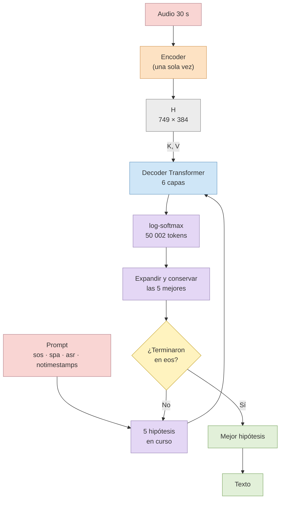

1. **Encoder.** El audio preprocesado pasa una sola vez por el encoder y se
   obtiene H (749 × 384). Durante toda la decodificación, H no cambia: es la
   memoria acústica que el decoder consulta.

2. **Paso del decoder.** Para cada hipótesis en curso, el decoder recibe los
   tokens generados hasta ahora (al inicio, solo el prompt). En cada una de sus
   6 capas aplica *self-attention* enmascarada sobre esos tokens y
   *cross-attention* sobre H (sección 3.7). La salida del último token pasa por
   una capa lineal de 384 → 50 002 y un log-softmax: es la log-probabilidad de
   cada token del vocabulario de ser el siguiente.

3. **Beam search.** Escoger siempre el token más probable (búsqueda *greedy*)
   puede llevar a una frase peor en conjunto: un error temprano ya no se
   corrige. El beam search mantiene las **k = 5** secuencias parciales más
   probables. En cada paso, extiende cada una con sus mejores candidatos, suma
   los puntajes y conserva solo las 5 mejores del total. El puntaje de una
   hipótesis es la suma de las log-probabilidades de sus tokens:

   $$\text{score}(y_{1:i}) = \sum_{j=1}^{i} \log p\left(y_j \mid y_{<j},\, H\right)$$

4. **Fin de la búsqueda.** Una hipótesis termina cuando genera `<eos>`. La
   búsqueda se detiene cuando no quedan hipótesis abiertas, cuando la regla de
   detección de fin de ESPnet determina que las hipótesis más recientes tienen
   puntajes muy inferiores al de la mejor ya terminada, o al llegar al máximo de
   749 tokens (`maxlenratio = 0`, sección 4.4). Se devuelve la hipótesis
   terminada con mayor puntaje.

5. **Posprocesamiento.** La secuencia ganadora, por ejemplo
   `[<sos>, <spa>, <asr>, <notimestamps>, ▁hola, ▁mundo, <eos>]`, se limpia:
   - se quitan el prompt y `<eos>`;
   - los IDs se convierten en tokens con la lista del vocabulario;
   - el tokenizador SentencePiece une los tokens en texto. El símbolo `▁` marca
     el inicio de una palabra y se reemplaza por un espacio;
   - se obtienen dos versiones: el texto crudo, con tokens especiales como las
     marcas de tiempo, y el texto limpio, sin ellos.

La función `transcribir()` de `modelo.py` ejecuta exactamente este proceso y
devuelve el texto y los tokens. La interfaz usa una versión extendida, descrita a
continuación.

### 5.7 Extracción de la cross-attention

ESPnet entrega el texto, pero no los pesos de atención que lo produjeron. La
función `inferir_con_atencion()` de `owsm_demo/atencion.py` los recupera en tres
etapas:

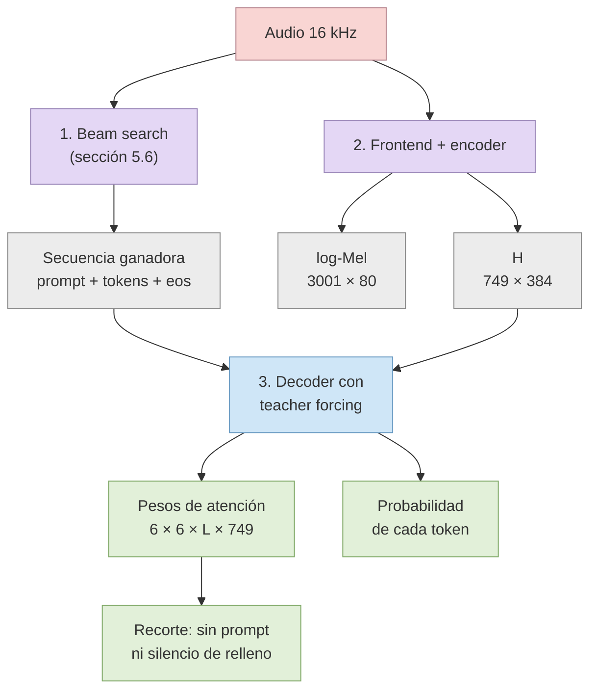

1. **Beam search normal.** Se decodifica como en la sección 5.6 y se guarda la
   secuencia ganadora completa (`hyp.yseq`), incluido el prompt.

2. **Encoder.** Se repite el preprocesamiento y se llama por separado al frontend
   y al encoder, para conservar dos tensores que el beam search no devuelve: el
   log-Mel (3001 × 80), que se dibuja en la interfaz, y H (749 × 384). Con ellos
   se calcula también cuántos segundos representa cada frame de H:
   30 s / 749 ≈ **40 ms**.

3. **Decoder con *teacher forcing*.** Se le entrega al decoder, de una sola vez,
   la secuencia ganadora sin `<eos>` junto con H. Como el decoder usa una máscara
   causal, cada posición ve exactamente los mismos tokens previos que vio durante
   el beam search, así que la atención resultante es la misma que produjo el
   texto. En cada capa, la *cross-attention* calcula:

   $$Q = S\,W_Q \;\; (L \times 384), \qquad K = H\,W_K \;\; (749 \times 384), \qquad V = H\,W_V \;\; (749 \times 384)$$

   $$A = \text{softmax}\left(\frac{QK^\top}{\sqrt{d_k}}\right) \;\; (L \times 749)$$

   donde S son los estados del decoder después de su *self-attention* (uno por
   token) y L es el número de tokens. Las *queries* vienen del texto; las *keys*
   y los *values*, del audio. La fila *i* de A dice a qué frames de 40 ms miró el
   decoder para predecir el token *i* + 1. Cada capa guarda A en
   `src_attn.attn`, y al apilar las 6 capas, cada una con sus 6 cabezas
   (d<sub>k</sub> = 64), se obtiene un tensor de **6 × 6 × L × 749**.

4. **Desactivar SDPA.** PyTorch tiene implementaciones optimizadas de la atención
   (*scaled dot-product attention* y *flash attention*) que calculan el
   resultado sin guardar la matriz A. Para poder leerla, se activa
   temporalmente la implementación manual de ESPnet y, al terminar, se restaura
   la configuración original (bloque `try / finally`).

5. **Probabilidad de cada token.** Con los *logits* de esta misma pasada se
   aplica softmax y se lee la probabilidad que el decoder asignó al token que
   finalmente se eligió. Es la medida de confianza que muestra la interfaz.

6. **Recorte.** Se eliminan las filas que corresponden al prompt (solo interesan
   los tokens generados por el modelo) y las columnas posteriores al final del
   audio real, que solo contienen el silencio de relleno.

**¿Por qué no leer la atención durante el beam search?** El beam search mantiene
5 hipótesis a la vez y en cada paso descarta la mayoría, por lo que la atención
calculada mezcla la de hipótesis que no sobrevivieron. Con *teacher forcing* se
recalcula en una sola pasada y únicamente para la secuencia ganadora.

### 5.8 Interfaz de visualización

`app.py` organiza la interfaz en el mismo orden del proceso: entrada,
configuración, inferencia, salida y atención.

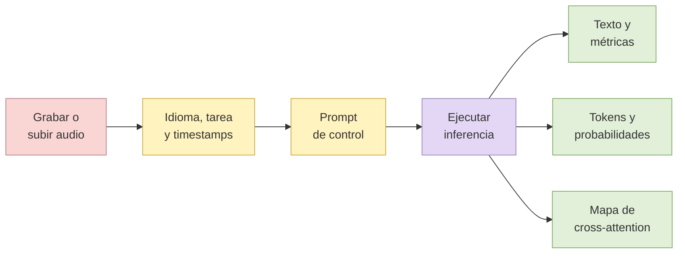

1. **Entrada.** El audio se graba desde el micrófono (`st.audio_input`) o se sube
   como archivo wav, mp3, flac u ogg. La interfaz muestra un reproductor, la
   duración, la frecuencia de muestreo y el número de muestras.

2. **Configuración.** En la barra lateral se elige el idioma del audio (8
   opciones), la tarea (transcribir o traducir a inglés, español, francés,
   alemán o portugués) y si se predicen marcas de tiempo. Con esa selección se
   muestra el prompt exacto que recibirá el decoder. La barra lateral muestra
   también la fecha, el dispositivo (CPU o CUDA) y el modelo usado.

3. **Inferencia.** Al presionar *Ejecutar inferencia* se llama a
   `inferir_con_atencion()` y el resultado se guarda en `st.session_state`. Así,
   cambiar de capa o de cabeza en el mapa de atención no repite la inferencia:
   solo se vuelve a dibujar.

4. **Salida.** Se muestran el texto generado y cuatro métricas:

   | Métrica | Cálculo | Interpretación |
   |---|---|---|
   | Tiempo de inferencia | segundos medidos con `time.perf_counter()` | Incluye el beam search y la extracción de atención. |
   | Tokens generados | número de tokens después del prompt | Longitud de la salida en subpalabras, no en palabras. |
   | RTF (*Real-Time Factor*) | tiempo de inferencia / duración del audio | Menor que 1: más rápido que el tiempo real. |
   | Confianza media | promedio de p(token elegido) | Valores bajos suelen señalar palabras dudosas o errores. |

   Un desplegable muestra el texto crudo, con tokens especiales, y la tabla de
   tokens con la probabilidad de cada uno.

5. **Cross-attention.** Un gráfico doble comparte el eje de tiempo:
   - **Arriba:** el log-Mel que entra al encoder (80 bandas, 10 ms por frame).
   - **Abajo:** el mapa de atención A. Cada fila es un token generado (*query*) y
     cada columna, un frame de H de 40 ms (*key*).

   Se puede ver el promedio de todas las capas y cabezas, o una capa y una cabeza
   en particular. Al elegir una capa, un desplegable muestra sus 6 cabezas lado a
   lado para comparar en qué se especializa cada una. En transcripción se espera
   un patrón aproximadamente **diagonal**: las palabras se escriben en el mismo
   orden en que se pronunciaron.

---

## 6. Resultados y análisis

Este proyecto no entrena ni reevalúa el modelo sobre los conjuntos de prueba
oficiales: eso requiere decenas de miles de audios con transcripción de
referencia y una GPU. Por eso, las secciones 6.1 a 6.9 analizan las métricas
publicadas por los autores en el artículo [1], con énfasis en el modelo **base**
que usamos. La sección 6.10 reúne, aparte, los resultados de nuestras propias
pruebas de inferencia.

### 6.1 Métricas utilizadas

| Métrica | Tarea | Qué mide | Mejor |
|---|---|---|---|
| **WER** (*Word Error Rate*) | ASR | Porcentaje de palabras mal reconocidas. | ↓ menor |
| **CER** (*Character Error Rate*) | ASR en chino, japonés, coreano | Igual que WER, pero por caracteres, porque esos idiomas no separan palabras con espacios. | ↓ menor |
| **BLEU** | Traducción (ST) | Coincidencia de secuencias de palabras (n-gramas) con una traducción de referencia, de 0 a 100. | ↑ mayor |
| **Speed-up** | Todas | Velocidad de decodificación relativa a OWSM v3 medium (= 1.00x). 3.67x significa 3.67 veces más rápido. | ↑ mayor |
| **Exactitud LID** | Identificación de idioma | Porcentaje de audios cuyo idioma se identifica correctamente. | ↑ mayor |
| **F1** | Comprensión del habla (SLU) | Media armónica entre precisión y exhaustividad. | ↑ mayor |

El WER se calcula comparando la transcripción del modelo con la de referencia:

$$\text{WER} = \frac{S + D + I}{N}$$

donde S son las palabras sustituidas, D las borradas, I las insertadas y N el
número de palabras de la referencia. Un WER de 12.1 % significa que, en promedio,
hay unos 12 errores por cada 100 palabras. Como I no tiene límite, el WER puede
superar el 100 %.

### 6.2 Condiciones de evaluación del artículo

- **Decodificación *greedy*:** los autores escogen siempre el token más
  probable. Nuestra aplicación usa *beam search* con k = 5 (sección 5.6), que
  suele dar igual o menos errores, pero es más lenta.
- **Normalización del texto:** antes de calcular el WER aplican el normalizador
  de Whisper (minúsculas, sin puntuación, números unificados), para no contar
  como error diferencias de formato.
- **Hardware:** la velocidad se mide en una GPU NVIDIA A40. El speed-up es
  relativo, así que no se puede comparar directamente con tiempos absolutos en
  CPU (sección 6.10).
- **Comparación justa:** OWSM v3.1 usa **los mismos 180 mil horas de datos** que
  OWSM v3. Cualquier mejora se debe a la arquitectura y al entrenamiento, no a
  más datos.

### 6.3 Comparación de encoders

Antes de entrenar los modelos finales, los autores compararon tres encoders
con el mismo decoder y el mismo tamaño total: Transformer (366M), Conformer
(367M) y E-Branchformer (367M). Entrenaron con el 10 % de los datos y
compararon la pérdida de validación durante los primeros 105 mil pasos.

**Resultado:** el E-Branchformer converge más rápido que los otros dos (figura 2
del artículo). Por eso se eligió para OWSM v3.1. Los autores no compararon la
convergencia completa porque cada entrenamiento tarda más de una semana con 16
GPUs.

**Análisis:** esta es la justificación experimental de la arquitectura descrita
en la sección 3.5. La ventaja viene de combinar en cada bloque el contexto
global (atención) con el local (cgMLP), en lugar de solo atención.

### 6.4 Reconocimiento de voz en inglés

WER (%) en nueve conjuntos de prueba en inglés (tabla 2 del artículo):

| Conjunto de prueba | Whisper base | Whisper small | Whisper medium | OWSM v3 medium | **v3.1 base** | v3.1 small | v3.1 medium |
|---|---|---|---|---|---|---|---|
| CommonVoice | 25.2 | 15.7 | 11.9 | 14.5 | **21.5** | 14.3 | 12.6 |
| FLEURS | 12.4 | 9.6 | 6.4 | 10.9 | **14.8** | 10.3 | 9.0 |
| LibriSpeech clean | 5.1 | 3.3 | 2.8 | 2.7 | **3.6** | 2.5 | 2.4 |
| LibriSpeech other | 12.0 | 7.7 | 6.5 | 6.0 | **9.1** | 5.8 | 5.0 |
| MLS | 13.4 | 9.1 | 10.2 | 7.4 | **12.0** | 8.1 | 7.1 |
| Switchboard | 25.7 | 22.2 | 19.4 | 17.2 | **22.9** | 17.4 | 16.3 |
| TEDLIUM | 6.3 | 4.6 | 5.1 | 4.8 | **7.8** | 5.0 | 5.1 |
| VoxPopuli | 10.2 | 8.5 | 7.6 | 9.2 | **12.0** | 9.1 | 8.4 |
| WSJ | 5.0 | 4.3 | 2.9 | 13.4 | **5.3** | 3.8 | 3.5 |
| **WER promedio ↓** | 12.8 | 9.4 | 8.1 | 9.6 | **12.1** | 8.5 | 7.7 |
| **Speed-up ↑** | 2.97x | 1.81x | 0.94x | 1.00x | **3.67x** | 2.21x | 1.24x |

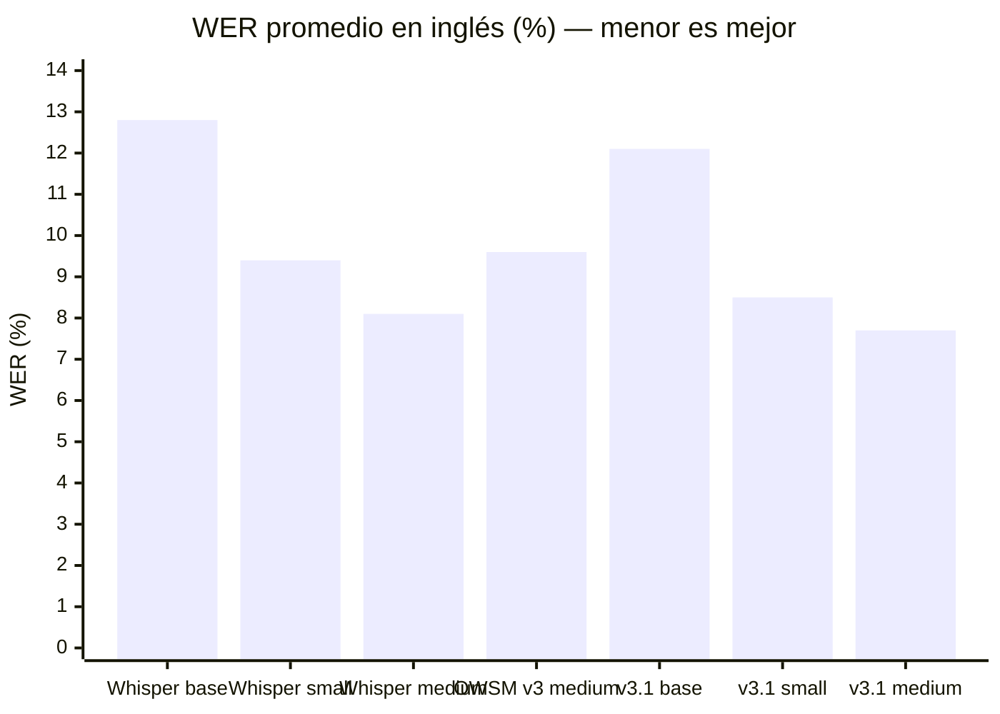

**Análisis:**

1. **Frente a OWSM v3.** OWSM v3.1 medium baja el WER promedio de 9.6 % a 7.7 %
   y gana en 8 de 9 conjuntos, con los mismos datos. Además, es un 24 % más
   rápido (1.24x), sobre todo porque su decoder es más pequeño. Esto confirma el
   aporte del encoder E-Branchformer.

2. **Frente a Whisper.** En cada tamaño, OWSM v3.1 logra un WER promedio menor:
   12.1 frente a 12.8 (base), 8.5 frente a 9.4 (small) y 7.7 frente a 8.1
   (medium). Lo hace con unas **6 veces menos horas de inglés** (73 mil frente a
   438 mil).

3. **El modelo base que usamos.** Es el **más rápido de toda la tabla (3.67x)**,
   gracias al submuestreo ×4 de 40 ms (sección 3.4), el doble del de Whisper, y
   a su decoder pequeño. Frente a Whisper base gana en 5 de 9 conjuntos
   (CommonVoice, LibriSpeech clean y other, MLS, Switchboard), pero pierde en
   FLEURS, TEDLIUM, VoxPopuli y WSJ. Es decir, su ventaja promedio no es
   uniforme.

4. **El tipo de audio importa más que el modelo.** En el base, el WER va de
   3.6 % en LibriSpeech clean (lectura limpia de audiolibros) a 9.1 % en
   LibriSpeech other (lectura más difícil) y 22.9 % en Switchboard
   (conversación telefónica espontánea). El habla espontánea y con ruido es la
   más difícil.

5. **Escalado con rendimientos decrecientes.** Pasar de base a small baja el WER
   de 12.1 a 8.5 (−3.6 puntos) con 3.6 veces más parámetros. Pasar de small a
   medium solo lo baja a 7.7 (−0.8 puntos) con 2.8 veces más parámetros y casi
   la mitad de velocidad.

### 6.5 Reconocimiento de voz multilingüe

WER o CER (%) y horas de entrenamiento de cada idioma (tabla 3 del artículo):

| Idioma (conjunto) | Métrica | Horas Whisper | Whisper base | Whisper medium | Horas OWSM | OWSM v3 medium | **v3.1 base** | v3.1 small | v3.1 medium |
|---|---|---|---|---|---|---|---|---|---|
| **Español (MLS)** | WER | 11.1K | 14.5 | 6.1 | 2.0K | 11.7 | **18.5** | 10.8 | 9.0 |
| Francés (MLS) | WER | 9.8K | 25.2 | 9.7 | 2.5K | 14.1 | **24.2** | 14.1 | 12.1 |
| Alemán (MLS) | WER | 13.3K | 19.9 | 8.1 | 3.7K | 11.9 | **18.7** | 12.4 | 10.8 |
| Neerlandés (MLS) | WER | 2.1K | 30.9 | 12.2 | 1.7K | 17.7 | **28.6** | 19.7 | 18.1 |
| Italiano (MLS) | WER | 2.6K | 32.9 | 15.6 | 0.7K | 24.5 | **33.7** | 21.8 | 20.2 |
| Portugués (MLS) | WER | 8.6K | 23.5 | 8.9 | 0.3K | 28.2 | **44.9** | 26.7 | 21.6 |
| Polaco (MLS) | WER | 4.3K | 25.2 | 6.8 | 0.3K | 37.0 | **49.7** | 28.5 | 25.2 |
| Chino (AISHELL-1) | CER | 23.4K | 39.1 | 15.7 | 16.0K | 7.1 | **12.2** | 7.5 | 6.4 |
| Coreano (Kspon clean) | CER | 8.0K | 27.0 | 17.6 | 1.0K | 20.5 | **23.8** | 17.2 | 16.7 |
| Coreano (Kspon other) | CER | 8.0K | 22.9 | 12.8 | 1.0K | 22.6 | **26.1** | 18.9 | 18.9 |
| Japonés (ReazonSpeech) | CER | 7.1K | 54.1 | 25.3 | 18.9K | 11.3 | **11.2** | 8.5 | 7.9 |
| **Promedio ↓** | | | 28.7 | 12.6 | | 18.8 | **26.5** | 16.9 | 15.2 |

**Análisis:**

1. **La cantidad de datos por idioma explica el resultado.** Donde OWSM tiene
   pocas horas (portugués y polaco, 0.3 mil), el base supera el 44 % de WER.
   Donde tiene muchas (chino, 16 mil; japonés, 18.9 mil), supera incluso a
   Whisper medium: 11.2 % de CER en japonés frente a 25.3 %.

2. **Español, el idioma de nuestra demostración.** El modelo base obtiene
   **18.5 % de WER** en MLS (audiolibros leídos en español): cerca de 1 de cada
   5 palabras con error. Whisper base logra 14.5 %, pero se entrenó con 11.1 mil
   horas de español, frente a solo 2 mil de OWSM. Es una referencia realista de
   lo que se puede esperar en nuestra aplicación con habla clara.

3. **Frente a OWSM v3.** El medium mejora en 10 de 11 conjuntos y baja el
   promedio de 18.8 % a 15.2 %.

4. **Frente a Whisper.** OWSM v3.1 todavía pierde en la mayoría de idiomas
   europeos, donde Whisper tiene entre 1.2 y 29 veces más horas. Los autores
   concluyen que el límite actual son los datos, no la arquitectura.

### 6.6 Traducción de voz

**Hacia el inglés** (BLEU, CoVoST-2, tabla 4 del artículo):

| Idioma de origen | Horas OWSM | Whisper base | Whisper medium | OWSM v3 medium | **v3.1 base** | v3.1 small | v3.1 medium |
|---|---|---|---|---|---|---|---|
| Alemán | 0.2K | 11.4 | 33.6 | 16.2 | **7.3** | 15.1 | 17.1 |
| **Español** | 0.1K | 19.2 | 39.7 | 20.5 | **10.0** | 19.3 | 22.3 |
| Francés | 0.3K | 13.1 | 34.4 | 21.7 | **11.1** | 20.3 | 22.7 |
| Catalán | 0.1K | 9.7 | 29.2 | 16.8 | **9.0** | 16.2 | 18.4 |
| **BLEU promedio ↑** | | 13.4 | 34.2 | 18.8 | **9.4** | 17.7 | 20.1 |
| **Speed-up ↑** | | 2.14x | 0.98x | 1.00x | **3.23x** | 2.26x | 1.16x |

**Desde el inglés** hacia 15 idiomas (tabla 5 del artículo), el BLEU promedio es
13.0 en OWSM v3 medium y **4.9 en v3.1 base**, 10.6 en small y 13.3 en medium. El
base es 3.00x más rápido. Whisper no puede traducir en esas direcciones: solo
traduce hacia el inglés.

**Análisis:**

1. **La traducción es el punto más débil del modelo base.** Con un BLEU de 10.0
   de español a inglés, la traducción conserva parte del sentido, pero no es
   fluida. Esto es coherente con la advertencia que muestra nuestra interfaz.

2. **Pocos datos de traducción.** OWSM tiene entre 100 y 300 horas por
   dirección hacia el inglés, frente a miles en Whisper. Por eso Whisper medium
   supera a OWSM v3.1 medium por 14 puntos de BLEU (34.2 frente a 20.1).

3. **El tamaño importa más en traducción que en transcripción.** De base a small,
   el BLEU casi se duplica (9.4 → 17.7), mientras que el WER en inglés mejora
   alrededor de un 30 %. Traducir exige más capacidad que transcribir.

4. **Direcciones sin evaluar.** Los 15 idiomas destino de la tabla 5 no incluyen
   español, francés ni portugués. Por lo tanto, las opciones *Traducir → español,
   francés o portugués* de nuestra aplicación no tienen una métrica publicada.

### 6.7 Audio largo

Para audios de más de 30 s, el modelo procesa ventanas consecutivas de 30 s y
avanza según las marcas de tiempo que predice. WER (%) en TEDLIUM con charlas
completas (tabla 6 del artículo):

| Whisper base | Whisper small | Whisper medium | OWSM v3 medium | **v3.1 base** | v3.1 small | v3.1 medium |
|---|---|---|---|---|---|---|
| 5.3 | 4.4 | 3.8 | 9.2 | **9.6** | 6.7 | 5.7 |

**Análisis:** el modelo base empeora de 7.8 % (segmentos cortos, tabla 2) a
9.6 % con audio largo, y queda lejos de Whisper base (5.3 %). Según los autores,
muchos conjuntos públicos solo traen audio ya segmentado en frases cortas, así
que el modelo casi no ve audio largo continuo durante el entrenamiento. Esto
respalda la decisión de limitar nuestra aplicación a 30 s.

### 6.8 Identificación de idioma

Exactitud (%) de identificación de idioma en FLEURS (tabla 7 del artículo):

| Whisper base | Whisper small | Whisper medium | OWSM v3 medium | **v3.1 base** | v3.1 small | v3.1 medium |
|---|---|---|---|---|---|---|
| 47.6 | 53.1 | 54.8 | 81.4 | **41.9** | 67.1 | 75.6 |

**Análisis:** el modelo base solo identifica bien el idioma en el 41.9 % de los
casos, el peor valor de la tabla. De base a medium, la exactitud casi se duplica
(41.9 % → 75.6 %), mientras que en Whisper apenas sube (47.6 % → 54.8 %). Con un
modelo base no conviene dejar que el modelo adivine el idioma. Por eso nuestra
aplicación le pide al usuario el idioma y lo fija en el prompt (`<spa>`,
`<eng>`…).

### 6.9 Otros resultados del artículo

**Comprensión del habla** (tabla 8, solo modelo medium). Se congela el encoder y
se entrena encima un decoder pequeño para cada tarea:

| Tarea | Métrica | OWSM v3 | OWSM v3.1 |
|---|---|---|---|
| Análisis de sentimiento | F1 | 60.1 | 56.2 |
| Reconocimiento de entidades | F1 | 54.8 | 65.8 |
| Localización de entidades | frame-F1 | 40.5 | 50.4 |
| Clasificación de actos de diálogo | F1 | 56.5 | 64.8 |

El encoder E-Branchformer mejora en 3 de 4 tareas, con hasta 11 puntos más. Esto
indica que sus representaciones (H) sirven también fuera de la transcripción.

**Sesgo contextual sin entrenamiento** (tabla 9). Al darle al modelo una lista de
100 palabras raras como prompt, se espera que las reconozca mejor (B-WER) sin
empeorar las demás (U-WER). En LibriSpeech test-other:

| Modelo | WER sin lista | WER con lista | U-WER sin → con | B-WER sin → con |
|---|---|---|---|---|
| **v3.1 base** | 9.48 | 12.49 | 6.89 → 10.45 | 32.17 → 30.36 |
| v3.1 small | 6.16 | 5.89 | 4.21 → 4.48 | 23.27 → 18.34 |
| v3.1 medium | 5.31 | 5.03 | 3.52 → 3.86 | 21.12 → 15.35 |

El modelo base empeora: no distingue las palabras útiles de las distractoras.
Small y medium sí aprovechan la lista. Los autores lo interpretan como una
**habilidad emergente**, que solo aparece a partir de cierto tamaño, como en los
grandes modelos de lenguaje. Esto justifica que nuestra aplicación no use el
prompt de texto previo (`text_prev`) con el modelo base.

### 6.10 Resultados de nuestras pruebas de inferencia

La primera prueba documentada de la aplicación, con su captura de pantalla en [`docs/AVANCE-PROYECTO.pdf`](docs/AVANCE-PROYECTO.pdf):

| Campo | Valor |
|---|---|
| Fecha | 2026-11-21 12:57:13 |
| Modelo | `espnet/owsm_v3.1_ebf_base` (101M) |
| Dispositivo | CPU |
| Audio | Grabado con el micrófono: 3.7 s, 16 000 Hz mono, 59 520 muestras |
| Prompt | `<sos> <spa> <asr> <notimestamps>` |
| Texto obtenido | "vamos a sacar cinco en esta tarea" |
| Tiempo de inferencia | 21.18 s |
| Tokens generados | 12 (incluye `<eos>`) |
| RTF | 5.69 |
| Confianza media por token | 70 % |

**Análisis:**

1. **Funciona de extremo a extremo.** El audio se grabó en la interfaz, se
   procesó con el modelo preentrenado y produjo una frase completa y coherente en
   español. Esto cumple el requisito de inferencia funcional con visualización.

2. **El RTF mayor que 1 se explica por la ventana fija de 30 s.** Un RTF de 5.69
   significa que procesar 3.7 s de audio tardó 5.7 veces más que su duración.
   Pero el modelo no procesa 3.7 s: rellena con silencio hasta 30 s (sección
   5.4), así que el encoder trabaja siempre sobre 749 frames. Medido sobre la
   ventana real, el costo es 21.18 / 30 ≈ **0.71 s por segundo de audio**. Por
   eso el RTF de un audio corto parece alto. (Esta explicación se corrige en la
   sección 6.10.5: con más mediciones, el tiempo depende sobre todo de los
   tokens generados.)

3. **Diferencias con la velocidad del artículo.** El artículo mide en una GPU
   A40, con decodificación *greedy* y sin extraer la atención. Nuestra medición
   se hizo en CPU, con *beam search* de 5 hipótesis, e incluye la segunda pasada
   del decoder para leer la atención (sección 5.7). Los tres factores aumentan el
   tiempo, así que las cifras no son comparables directamente.

4. **Confianza del 70 %.** Es el promedio de la probabilidad que el decoder dio a
   cada uno de los 12 tokens. Un valor medio como este suele combinar tokens muy
   seguros con algunos dudosos; la tabla de tokens de la interfaz permite ver
   cuáles son.

5. **Sin WER propio en esa prueba.** No se registró la frase que se dijo realmente,
   así que no se pudo calcular el error. Se resuelve en las pruebas con
   referencia de las secciones siguientes.

#### 6.10.1 Diseño de las pruebas con referencia

Para medir el error se grabaron 44 audios con la voz del autor, en un computador
Windows sin GPU, con `ctc_weight = 0` y *beam search* de 5 (la configuración de la
aplicación). Hay dos tipos de texto de referencia, para poder comparar:

- **Libro:** 24 frases de *Noches blancas* de Dostoievski (traducción al español de
  una edición digital libre), de 6 a 15 palabras. Es lenguaje literario del siglo
  XIX, con palabras poco frecuentes.
- **Cotidiano:** 12 frases escritas por nosotros, de 8 a 12 palabras, sobre
  situaciones de todos los días (café, reunión, bus, llaves).

Los fragmentos del libro y los audios no se publican en el repositorio.

| Grupo | Audios | Contenido |
|---|---|---|
| Frases del libro | `corta01` a `corta12`, `media01` a `media12` | 24 frases, 256 palabras |
| Frases cotidianas | `diaria01` a `diaria12` | 12 frases, 136 palabras |
| Largo | `larga` (26 s), `muylarga` (42 s) | 68 y 109 palabras; `muylarga` supera la ventana de 30 s |
| Inglés | `ingles01` a `ingles04` | 4 frases de 10 a 13 palabras |
| Traducción | `traduccion01` | Una frase en español pedida con `<st_eng>` |
| Silencio | `silencio` (19 s) | Sin hablar |

Las pruebas con ruido y de *beam search* usan las 36 frases (392 palabras). Antes de
calcular el error, ambos textos se normalizan: minúsculas, sin puntuación y números
escritos con palabras. Todo se ejecutó con `scripts/evaluar.py` (sección 6.11).

Con pocas palabras, el WER cambia mucho de una muestra a otra. Por eso, en esta
sección el WER global se acompaña de un **intervalo de confianza del 95 %**,
calculado remuestreando frases completas (*bootstrap*, 5000 repeticiones).

#### 6.10.2 Precisión: WER y CER

| Grupo | Palabras | Palabras erradas | WER | IC 95 % |
|---|---|---|---|---|
| Libro, frases cortas (`corta`) | 100 | 24 | 24.0 % | |
| Libro, frases medias (`media`) | 156 | 36 | 23.1 % | |
| **Libro, total** | 256 | 60 | **23.4 %** | 17.7 a 29.2 |
| **Cotidiano** | 136 | 21 | **15.4 %** | 7.0 a 24.5 |
| **Las 36 frases** | 392 | 81 | **20.7 %** | 15.7 a 25.8 |
| Largo (`larga`, 26 s) | 68 | | 26.5 % | |
| Inglés (4 frases) | 44 | 5 | 11.4 % | |

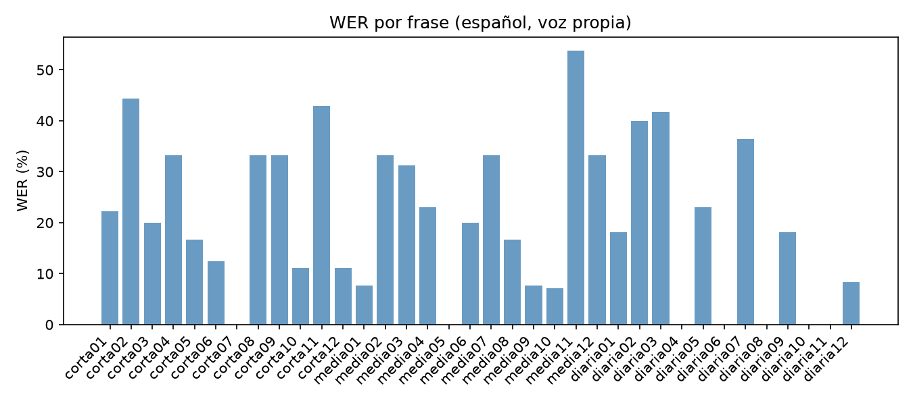

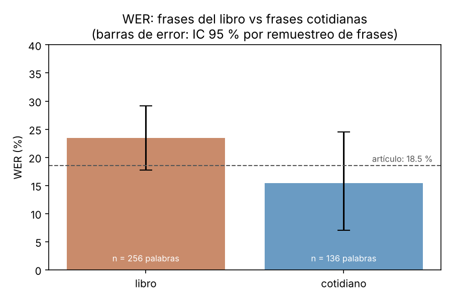

**Resultados:**

1. **WER global de las 36 frases: 20.7 %** (81 palabras erradas de 392), con un
   intervalo de 15.7 a 25.8 %. El artículo reporta 18.5 % para el modelo base en
   español leído (sección 6.5), que cae dentro del intervalo: **no podemos decir
   que el modelo rinda peor ni mejor que lo que reporta el artículo.**
2. **Libro contra cotidiano.** Con frases cotidianas el WER fue 15.4 %, frente a
   23.4 % con las del libro, una diferencia de 8.0 puntos. Va en el sentido que
   esperábamos (el vocabulario literario cuesta más), pero **el intervalo de la
   diferencia va de −2.8 a 18.3 puntos**: con estos datos no se puede asegurar que
   sea real. Además, el libro tiene palabras muy poco frecuentes en las que el
   modelo falla ("abuelita", "sollozo", "niebla" salieron "vuelita", "soyoso",
   "nieula"), pero también falló en palabras comunes ("hasta mañana" salió "esta
   mañana"). Hay más frases cotidianas perfectas (5 de 12) que del libro (2 de 24).
3. **El CER es menor que el WER** (5.0 % a 7.0 % de promedio contra 15 a 23 %): las
   palabras erradas suelen parecerse en sonido a la correcta. Un error de una
   letra cuenta como palabra entera en el WER.
4. **La confianza anticipa el error, pero poco.** En las 36 frases, la confianza
   media por token y el WER tienen una correlación de −0.43: las frases con más
   confianza tienden a tener menos error, pero con mucha dispersión. Sirve como
   señal de alerta, no como medida.
5. **`muylarga`.** El WER crudo (46.8 %) está inflado: el modelo solo procesó los
   primeros 30 s (sección 6.10.7). Contra la parte de la referencia que cabe en
   ese tiempo (las primeras 77 de 109 palabras, suponiendo ritmo constante), el WER
   es de ≈ 24.7 %, parecido al de `larga`.

#### 6.10.3 Efecto del ruido

Se sumó ruido blanco gaussiano a las 36 frases con una relación señal/ruido (SNR)
dada. Una SNR menor significa más ruido.

| Condición | WER |
|---|---|
| Sin ruido | 20.7 % |
| SNR 20 dB | 24.0 % |
| SNR 10 dB | 40.6 % |
| SNR 5 dB | 55.4 % |

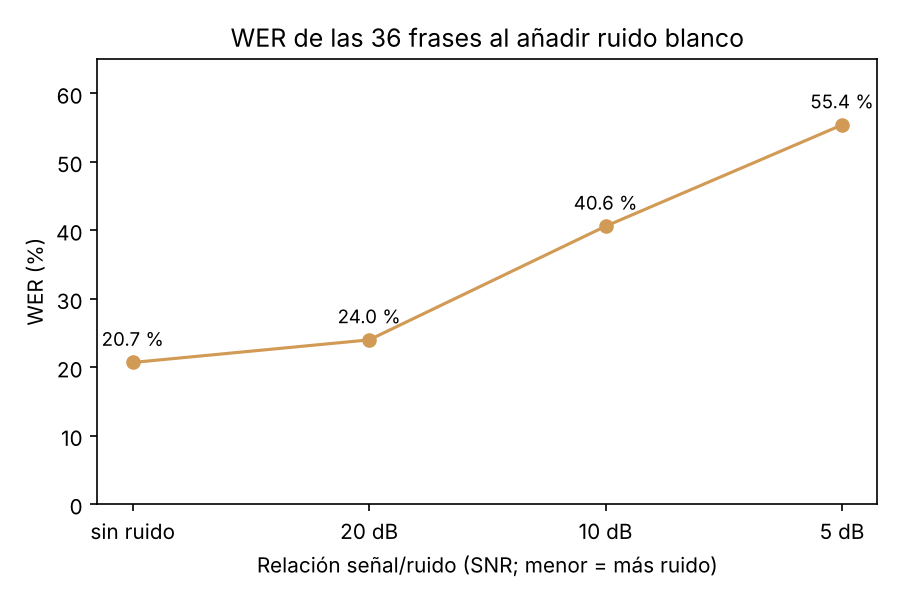

El WER sube a medida que baja la SNR: de 20.7 % a 55.4 % con SNR de 5 dB, es decir
que con ese nivel de ruido el modelo se equivoca en más de la mitad de las
palabras. Es ruido blanco sintético, fácil de reproducir pero distinto del ruido
de un lugar real (voces, ventiladores, calle), así que las cifras son una guía y no
una predicción para un ambiente concreto.

#### 6.10.4 *Beam search* de 5 contra *greedy*

| Beam | WER (36 frases) | Tiempo medio por frase |
|---|---|---|
| 1 (*greedy*) | 21.7 % | 1.8 s |
| 5 | 20.7 % | 4.6 s |

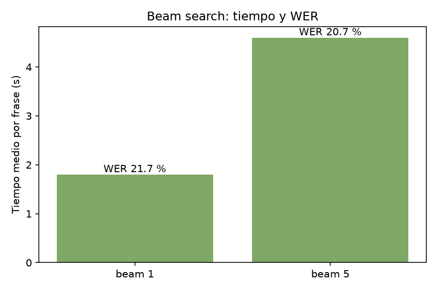

La diferencia de WER es de 1 punto (unas 4 palabras de 392), pequeña frente al
intervalo de ±5 puntos de la medición, así que **no hay evidencia de que el beam
search de 5 mejore el resultado en este conjunto**. Sí cuesta unas 2.6 veces más
tiempo. En una primera corrida, con solo 8 frases (94 palabras), la diferencia
parecía de 6 puntos; con más datos desapareció. Esto muestra por qué hace falta una
muestra grande antes de sacar conclusiones. Estos tiempos no incluyen la segunda
pasada para leer la atención.

#### 6.10.5 Tiempo de inferencia

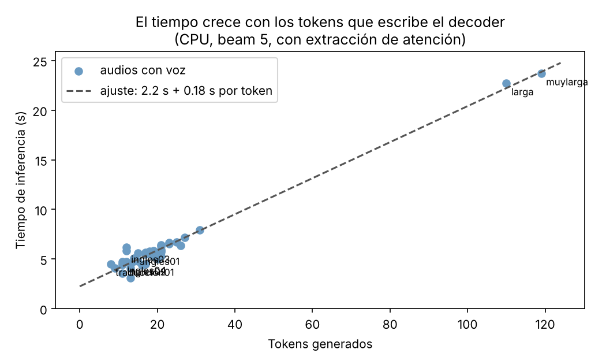

En los audios con voz (43 audios), el tiempo de inferencia sigue casi una recta con
los tokens que escribe el decoder: **≈ 2.2 s + 0.18 s por token**, con correlación
de 0.99. Es coherente con el funcionamiento autorregresivo (sección 5.6): el
encoder corre una sola vez y el decoder corre una vez por cada token.

**Matiz sobre la sección anterior (prueba inicial).** El análisis de la primera
prueba atribuye el RTF alto al costo fijo del encoder, que procesa siempre los
30 s. Nuestras mediciones respaldan que existe una parte fija, pero pequeña en este
equipo (≈ 2.2 s, frente a los ≈ 21 s de la prueba inicial) y que el resto depende
de los tokens. Esa parte fija pesa mucho en audios muy cortos (`corta05`, de
2.9 s, tuvo RTF 2.1) y poco en los largos. En general el RTF de los audios con voz
fue de 0.3 a 2.1, con promedio de 0.98 (con la salvedad de que las pruebas se
hicieron en un computador distinto al de la prueba inicial).

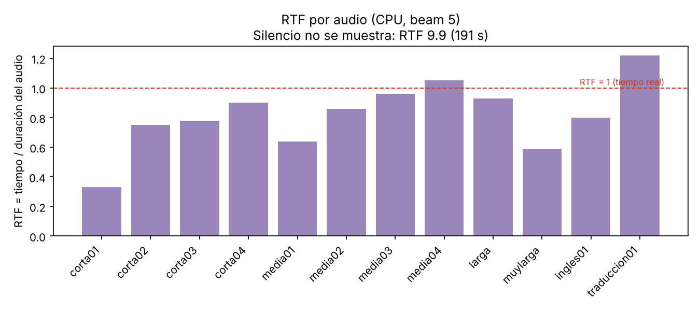

#### 6.10.6 Resumen de resultados propios

| Medida | Valor |
|---|---|
| WER global, 36 frases con beam 5 | 20.7 % (392 palabras, IC 95 % 15.7 a 25.8) |
| WER libro / cotidiano | 23.4 % / 15.4 % (diferencia no concluyente) |
| Referencia del artículo, español, modelo base | 18.5 % (sección 6.5) |
| WER con SNR de 20, 10 y 5 dB | 24.0 %, 40.6 % y 55.4 % |
| WER con *greedy* | 21.7 % (sin diferencia clara con beam 5) |
| Tiempo medio con voz y beam 5 | 6.2 s por audio (RTF medio 0.98, 43 audios) |
| Tiempo por token | ≈ 0.18 s, más ≈ 2.2 s fijos |

#### 6.10.7 Audio de más de 30 s

`muylarga` dura 42 s. ESPnet lo recortó a 30 s y lo avisó con una advertencia
(*"trimming the input ... to 480000 samples"*), que también sugiere usar
`decode_long()` para audios largos. El texto obtenido corresponde solo al
tramo inicial. Esto confirma la limitación de la ventana fija de 30 s (sección
6.7). Con `larga` (26 s), que sí cabe en la ventana, el modelo mantiene la
alineación en todo el audio (sección 6.12).

#### 6.10.8 Inglés y traducción

- **Inglés** (4 frases, 44 palabras): WER de 11.4 %. Casi todos los errores son
  verbos en pasado o presente que el modelo escribió sin la terminación ("record"
  por "recorded", "stage" por "stayed"), que quizás se debe a la pronunciación del
  autor, hablante nativo de español; no lo comprobamos. Son pocas frases y una sola
  voz, así que no equivale a medir el WER en inglés; para eso está la tabla del
  artículo (12.1 % de promedio para el modelo base, sección 6.4).
- **Traducción de español a inglés** (`traduccion01`): la salida mezcla palabras
  en inglés y español y no se entiende como una traducción; la confianza media
  fue de 0.40, la más baja salvo el silencio. Es coherente con el BLEU de 10.0 que
  el artículo reporta para el modelo base en esta dirección (sección 6.6). Es una
  sola frase.

#### 6.10.9 Silencio: alucinación

Con 19 s de silencio el modelo no devolvió una cadena vacía: escribió 48 tokens
que repiten una misma frase varias veces. Esto ocurrió igual en las dos corridas.
Dos observaciones:

- La confianza media fue la más baja de todas (0.31), por lo que podría servir
  para detectar este caso.
- La inferencia tardó 176 s (RTF 9.1) frente a los 23 s de `larga`, que
  escribió 110 tokens (más del doble). No medimos la causa, pero es compatible con
  que la búsqueda no terminara pronto (`maxlenratio = 0` permite hasta 749 tokens,
  sección 4.4).

La atención en este caso se ve en la sección 6.12.

### 6.11 Cómo reproducir las pruebas

Los scripts están en `scripts/` y se ejecutan con `uv` desde la raíz del repositorio:

```bash
# 1. Grabar los audios, leyendo audios/referencias.csv (WAV mono de 16 kHz)
uv run --with sounddevice --with soundfile python scripts/grabar.py

# 2. Probar con un solo audio
uv run --with jiwer --with num2words python scripts/evaluar.py --prueba

# 3. Corrida completa: precisión, ruido y beam search
uv run --with jiwer --with num2words python scripts/evaluar.py --ruido 20 10 5 --beams 1 5

# 4. Gráficas adicionales (tiempo contra tokens, RTF)
uv run --with matplotlib --with numpy python scripts/graficar_resultados.py
```

Los audios y el `referencias.csv` real no se publican (la voz es del autor y la
referencia incluye fragmentos de un libro); en `audios/referencias.ejemplo.csv` hay
una plantilla y las instrucciones están en `audios/README.md`. Los resultados
numéricos de nuestra corrida están en `docs/resultados/`.

`audios/referencias.csv` tiene una fila por audio con las columnas `archivo`, `tipo`
(`frase`, `largo`, `ingles`, `traduccion`, `silencio`), `idioma`, `tarea`,
`figura` (1 para guardar sus mapas de atención), `referencia` y `leer` (texto
a leer cuando difiere de la referencia, como en la traducción). El script genera
en `resultados/` las tablas `p1_resultados.csv`, `p2_ruido.csv` y `p3_beam.csv`,
el resumen `resumen.json` y todas las figuras. Reutiliza las funciones
`inferir_con_atencion` y `figura_atencion` de `owsm_demo/`.

### 6.12 Análisis de la cross-attention

Cada fila del mapa es un token generado y cada columna, un frame de 40 ms de H.
Se observaron cuatro cosas.

**1. En el habla, la atención sigue el orden del audio.** El mapa tiene un patrón
diagonal claro: cada token mira el tramo donde se pronunció esa palabra.

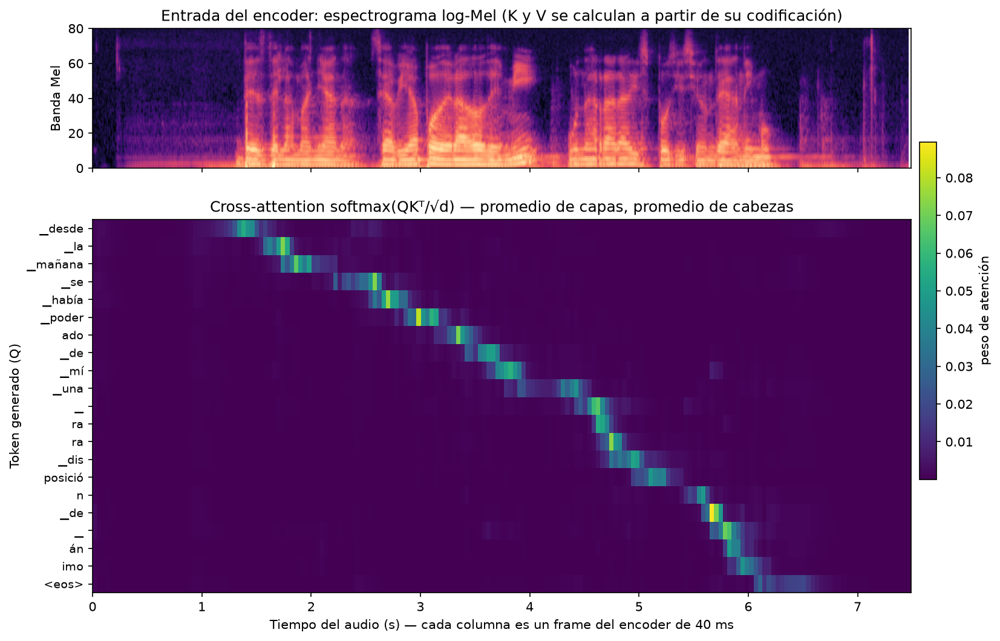

En `larga` la diagonal se mantiene a lo largo de los 26 s y los tokens de puntuación
caen en las pausas del espectrograma.

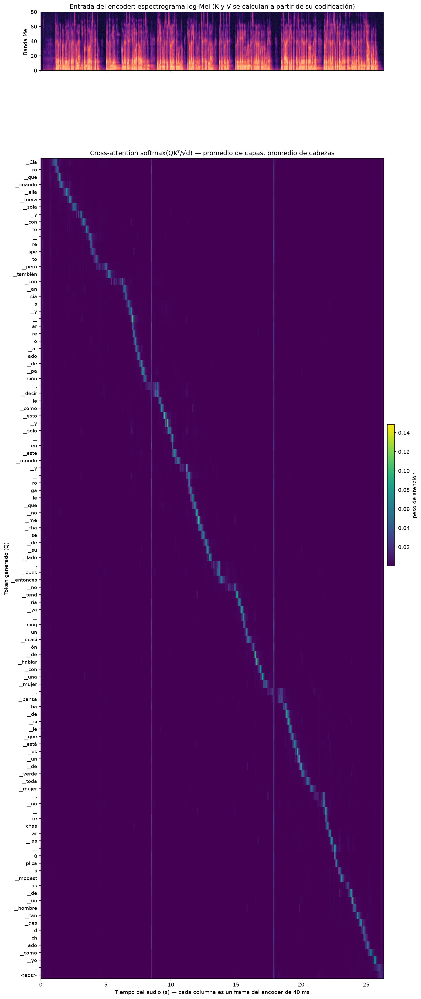

**2. Los errores se ven en el mapa.** En `corta01`, los tokens de "a" y "divi"
(que reemplazan "adiviné") miran justo el tramo en que se dijo esa palabra: el
modelo atiende al lugar correcto y se equivoca al escribir.

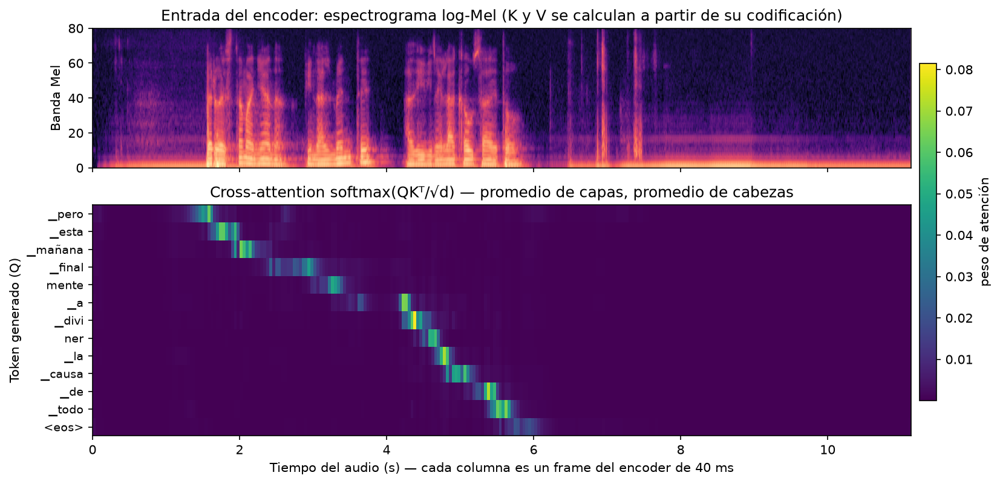

**3. Las capas y las cabezas se especializan.** Para cada capa y cabeza se midió
la correlación de Spearman entre el orden de los tokens y el orden de los frames
donde más atienden (1 es una diagonal perfecta), promediada sobre los 42
audios con voz (frases, largos e inglés). Esta medida solo comprueba el orden, no que el pico caiga
exactamente en el lugar correcto.

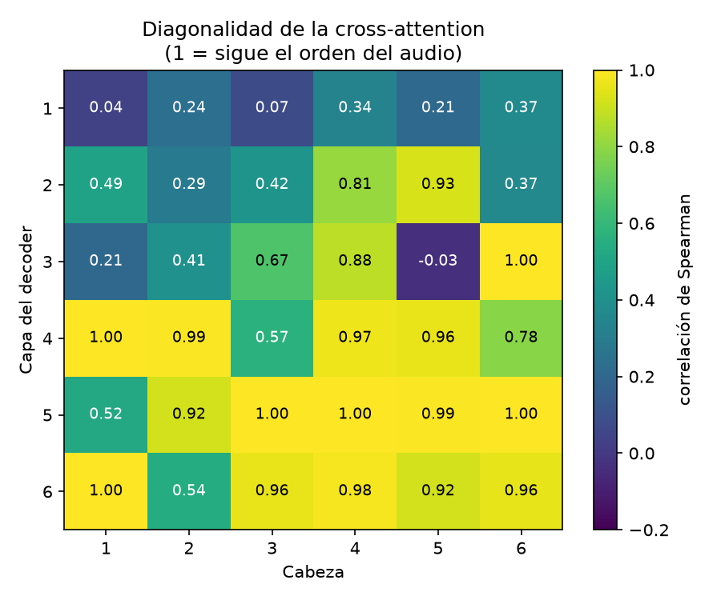

| Capa | 1 | 2 | 3 | 4 | 5 | 6 |
|---|---|---|---|---|---|---|
| Diagonalidad media | 0.21 | 0.55 | 0.52 | 0.88 | 0.91 | 0.89 |

14 de las 18 cabezas de las capas 4 a 6 superan 0.9, frente a 2 de las 18 de las
capas 1 a 3. Las últimas capas son las que alinean el texto con el audio, y las
primeras atienden de forma más dispersa. Dentro de una misma capa también hay
diferencias: en la capa 6, la cabeza 2 reparte la atención de forma difusa y las
demás son diagonales.

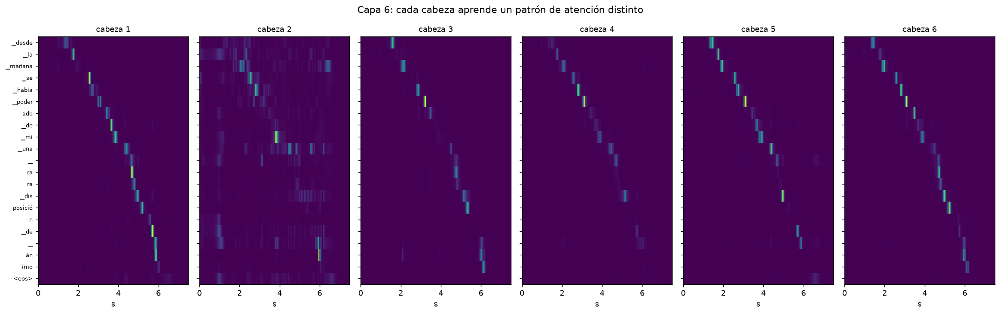

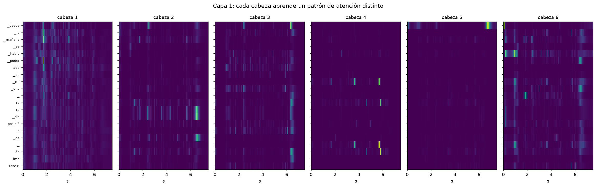

No medimos por qué las primeras capas no se alinean con el audio; es un
hallazgo descriptivo.

**4. Sin voz, la atención pierde la alineación.** En el silencio no hay diagonal:
la atención se concentra en los primeros frames del audio (menos de 0.3 s) y en un
chasquido cerca de los 15 s, mientras el decoder repite la misma frase.

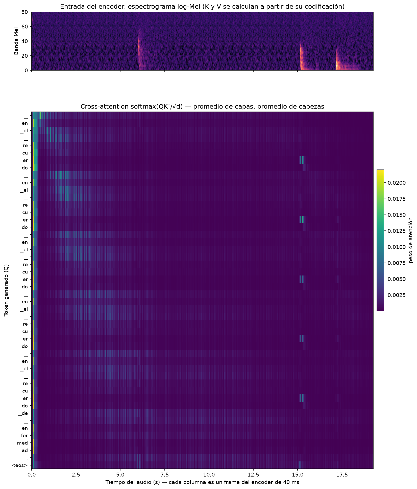

El patrón diagonal puede usarse como señal de que el texto corresponde al audio.
Su ausencia, junto con una confianza baja, delata una alucinación.

### 6.13 Limitaciones

- **Ventana fija de 30 s.** Los audios más largos se recortan (`muylarga`: de 42 a
  30 s) y el artículo muestra que el modelo rinde peor en audio largo (sección 6.7).
- **Pocos datos por idioma.** El modelo base obtiene 18.5 % de WER en español leído
  según el artículo, y 20.7 % en nuestras 36 frases (IC 95 % de 15.7 a 25.8). En portugués y polaco
  supera el 44 % (sección 6.5). El límite son los datos, no la arquitectura.
- **Sensibilidad al ruido.** Con SNR de 5 dB, el WER sube a 55.4 %.
- **Traducción débil.** BLEU de 10.0 de español a inglés en el artículo, y salida
  ininteligible en nuestra prueba (sección 6.10.8).
- **Alucinación con silencio.** Escribe texto repetido, con confianza baja, y tardó
  176 s (sección 6.10.9).
- **Identificación de idioma poco fiable.** Solo el 41.9 % de exactitud en el base
  (sección 6.8), por eso la aplicación fija el idioma en el prompt.
- **Velocidad.** El tiempo depende de los tokens (≈ 0.18 s por token en nuestro
  equipo, sin GPU) y no hay garantía de tiempo real.
- **Alcance de las pruebas propias.** Una sola voz y un solo micrófono, 392 palabras
  en las pruebas de precisión (intervalo de ±5 puntos), ruido blanco sintético y
  4 frases en inglés.
  Las cifras son orientativas y no equivalen a evaluar en los conjuntos oficiales.
- **Sin CTC en la inferencia.** Se usa `ctc_weight = 0` para poder explicar la
  salida con la cross-attention; la decodificación híbrida suele ser más robusta
  ante repeticiones u omisiones (sección 4.4).

### 6.14 Posibles mejoras

- **Audios largos:** usar `decode_long()`, que ESPnet sugiere en su advertencia, o
  procesar por ventanas de 30 s avanzando con las marcas de tiempo (sección 6.7).
- **Silencio:** detectar la ausencia de voz antes de decodificar y limitar la longitud
  máxima (`maxlenratio` mayor que 0) para evitar tiempos como los 176 s observados.
- **Confianza:** avisar al usuario cuando la confianza media sea baja (en nuestras
  pruebas, 0.31 en el silencio y 0.40 en la traducción fallida).
- **Interfaz:** agregar un campo de texto de referencia para calcular WER y CER, y un
  selector del tamaño del haz.
- **Decodificación híbrida:** probar `ctc_weight` mayor que 0 y comparar el WER con
  el de la atención sola.
- **Modelo:** usar GPU o el modelo medium si se necesita mayor calidad, con los costos
  de memoria de la sección 4.3.

---

## 7. Conclusiones

> _Borrador para revisar con el equipo. Resume las secciones 3 a 6: la arquitectura, lo
> que implementamos, lo que dice el artículo y lo que medimos nosotros. Si cambia algún
> resultado de la sección 6.10, hay que actualizar este texto._

### 7.1 Sobre la arquitectura y el modelo

- OWSM v3.1 conserva el diseño de Whisper (un Transformer encoder–decoder con tareas
  indicadas por tokens especiales) y cambia solo el encoder, que pasa a ser un
  E-Branchformer (sección 3.5). Cada bloque combina atención global con una rama local
  (cgMLP). Los autores muestran que converge más rápido que el Transformer y el
  Conformer (sección 6.3).
- Es un modelo **abierto y liviano**: la versión base tiene 101 millones de parámetros,
  se entrenó con datos públicos y corre en CPU. Es el más rápido de su tabla (3.67
  veces), gracias al submuestreo de ×4 (40 ms por frame) y a un decoder pequeño
  (sección 6.4).
- En inglés, v3.1 supera en promedio a Whisper en los tres tamaños que se comparan
  (12.1 frente a 12.8 en base) con unas 6 veces menos horas de inglés. El encoder
  nuevo también mejora 3 de 4 tareas de comprensión del habla (sección 6.9).

### 7.2 Los límites que muestra el artículo

- **Los datos pesan más que la arquitectura.** En español, el base tiene 18.5 % de WER
  frente a 14.5 % de Whisper base, que se entrenó con 11.1 mil horas contra 2 mil
  (sección 6.5). En portugués y polaco, con 0.3 mil horas, el WER pasa de 44 %.
- **Traducción débil:** BLEU de 10.0 de español a inglés, y sin métrica publicada hacia
  español (sección 6.6).
- **Identificación de idioma poco fiable (41.9 %):** por eso nuestra aplicación pide el
  idioma al usuario (sección 6.8).
- **Audio largo:** el WER sube de 7.8 % a 9.6 % y queda lejos de Whisper base (5.3 %).
  Por eso limitamos la aplicación a 30 s (sección 6.7).
- **Sesgo contextual:** solo funciona desde el tamaño small; el base empeora con la lista
  de palabras (sección 6.9).
- **Escalar tiene rendimientos decrecientes:** de base a small el WER baja 3.6 puntos;
  de small a medium, solo 0.8 (sección 6.4).

### 7.3 Lo que implementamos

Sin entrenar ni ajustar nada, cargamos los pesos publicados con ESPnet (sección 4.3) y
construimos una aplicación en Streamlit que recibe un audio, lo transcribe o traduce con
*beam search* de 5 hipótesis y `ctc_weight = 0` (sección 4.4), y **muestra la
cross-attention** del decoder (6 capas × 6 cabezas), extraída con una segunda pasada
(sección 5.7). La aplicación funciona de extremo a extremo en CPU.

### 7.4 Lo que verificamos con pruebas propias

Probamos 44 audios con una sola voz (sección 6.10):

- **Precisión en español:** WER de **20.7 %** en 36 frases (392 palabras; intervalo de
  confianza de 15.7 a 25.8 %). El 18.5 % del artículo cae dentro del intervalo, así que
  nuestros resultados son compatibles con él.
- **Ruido:** el WER sube de 20.7 % a 55.4 % con SNR de 5 dB.
- **Silencio:** el modelo inventa texto repetido, con confianza baja (0.31), que sirve
  como alerta.
- **Traducción:** la salida de nuestra prueba no se entiende, como sugiere el BLEU del
  artículo.
- **Audio de más de 30 s:** se recorta; solo se procesó el tramo inicial.
- **Cross-attention:** las capas 4 a 6 alinean cada token con el tramo de audio donde se
  pronunció (14 de 18 cabezas con diagonalidad mayor que 0.9). Esto permite explicar qué
  escuchó el modelo al escribir cada palabra y ver dónde se equivoca (sección 6.12).
- **Tiempo:** crece con los tokens generados (≈ 0.18 s por token en CPU, más ≈ 2.2 s
  fijos).

### 7.5 Lo que no podemos concluir

- **Libro contra frases cotidianas:** el WER fue menor en las cotidianas (15.4 % contra
  23.4 %), pero con nuestros datos la diferencia no es concluyente.
- **Beam search 5 contra *greedy*:** sin diferencia clara de WER (20.7 % contra 21.7 %),
  aunque beam 5 tarda unas 2.6 veces más.
- **Inglés y traducción:** 4 frases y 1 frase, muy pocas para dar cifras.
- **Generalización:** una sola voz y un solo micrófono; no sabemos cómo cambiaría con
  otras voces, acentos o ruido real.

### 7.6 Cierre

OWSM v3.1 base es una opción real para transcribir español claro sin GPU y permite
inspeccionar por dentro cómo decide cada palabra. Sus puntos débiles (ruido,
traducción, audio largo, silencio y poco español de entrenamiento) coinciden entre lo que
reporta el artículo y lo que medimos. Las mejoras propuestas están en la sección 6.14.

---

## 8. Referencias

> _Formato IEEE. Lista en construcción: cada sección agrega sus referencias y al
> final se unifica la numeración._

[1] Y. Peng, J. Tian, W. Chen, S. Arora, B. Yan, Y. Sudo, M. Shakeel, K. Choi, J. Shi, X. Chang, J.-w. Jung, and S. Watanabe, "OWSM v3.1: Better and faster open Whisper-style speech models based on E-Branchformer," in *Proc. Interspeech*, 2024. [Online]. Available: https://arxiv.org/abs/2401.16658

[2] A. Radford, J. W. Kim, T. Xu, G. Brockman, C. McLeavey, and I. Sutskever, "Robust speech recognition via large-scale weak supervision," in *Proc. ICML*, 2023.

[3] Y. Peng, J. Tian, B. Yan, *et al.*, "Reproducing Whisper-style training using an open-source toolkit and publicly available data," in *Proc. ASRU*, 2023.

[4] K. Kim, F. Wu, Y. Peng, *et al.*, "E-Branchformer: Branchformer with enhanced merging for speech recognition," in *Proc. SLT*, 2023.

[5] S. Watanabe, T. Hori, S. Karita, T. Hayashi, J. Nishitoba, Y. Unno, N. E. Y. Soplin, J. Heymann, M. Wiesner, N. Chen, A. Renduchintala, and T. Ochiai, "ESPnet: End-to-end speech processing toolkit," in *Proc. Interspeech*, 2018, pp. 2207–2211.

[6] T. Kudo and J. Richardson, "SentencePiece: A simple and language independent subword tokenizer and detokenizer for neural text processing," in *Proc. EMNLP: System Demonstrations*, 2018, pp. 66–71.
