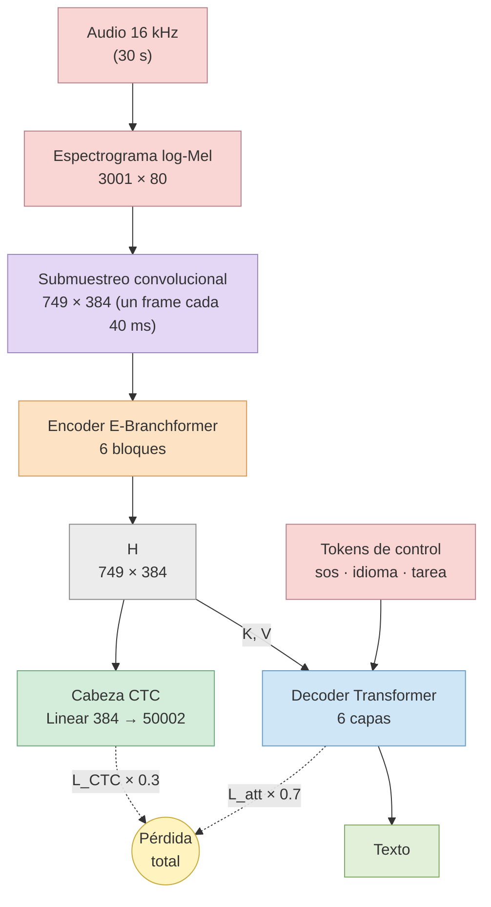
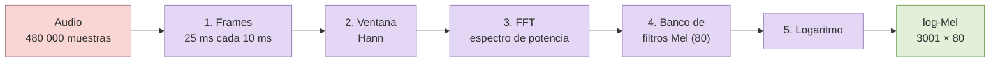
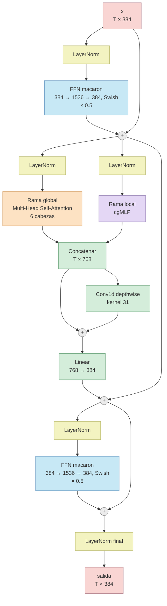

# OWSM v3.1: Inferencia y análisis de un Transformer encoder–decoder para voz a texto

Proyecto final — Procesamiento de Datos Secuenciales

**Integrantes:** _(completar nombres completos)_

---

## Contenido

1. [Resumen](#1-resumen)
2. [Introducción](#2-introducción)
3. [Marco teórico](#3-marco-teórico)
4. [Metodología](#4-metodología)
5. [Desarrollo e implementación](#5-desarrollo-e-implementación)
6. [Resultados y análisis](#6-resultados-y-análisis)
7. [Conclusiones](#7-conclusiones)
8. [Referencias](#8-referencias)

---

## 1. Resumen

> _Pendiente: se escribe al final, cuando estén los resultados._

---

## 2. Introducción

**Artículo base:** *OWSM v3.1: Better and Faster Open Whisper-Style Speech Models
based on E-Branchformer* (Peng et al., Interspeech 2024) [1] —
[arXiv:2401.16658](https://arxiv.org/abs/2401.16658)

**Repositorio original:** [ESPnet](https://github.com/espnet/espnet) ·
**Pesos:** [`espnet/owsm_v3.1_ebf_base`](https://huggingface.co/espnet/owsm_v3.1_ebf_base)

### Contexto

Con el crecimiento de la inteligencia artificial de código abierto, ha cobrado
importancia contar con modelos fundacionales completamente abiertos. En el caso
de los modelos de voz a texto, Whisper [2] ofrece un desempeño destacado, pero
OpenAI no publicó sus datos de entrenamiento ni el código para entrenarlo, lo
que impide reproducirlo, auditarlo o estudiarlo científicamente.

Como respuesta, Open Whisper-style Speech Model (OWSM) [3] busca reproducir el
entrenamiento de Whisper utilizando únicamente datos públicos y herramientas de
código abierto (180 mil horas de audio en 151 idiomas), y publica el código, los
pesos y los registros de entrenamiento. Sus versiones v1 a v3 se basan en la
arquitectura Transformer estándar.

La versión 3.1 presenta una familia de modelos que reemplaza el encoder por un
E-Branchformer [4] y mantiene el decoder como un Transformer tradicional. Con
este cambio, y sin datos adicionales, supera a OWSM v3 en la mayoría de las
pruebas y es hasta un 25 % más rápido en inferencia. Se publicó en tres tamaños:
base (101M), small (367M) y medium (1.02B parámetros).

### Motivación y objetivo

Elegimos OWSM v3.1 porque es un Transformer encoder–decoder aplicado a datos
secuenciales (audio → texto), con modificaciones al encoder que extienden el conocimiento
visto en clase, además es completamente abierto y su versión base puede
ejecutarse sin GPU.

El objetivo de este proyecto es entender la arquitectura del modelo OWSM v3.1, implementar la inferencia de su modelo
base y construir una interfaz interactiva que permita cargar audio, observar la
salida del modelo y analizar su mecanismo de atención.

---

## 3. Marco teórico

### 3.1 Antecedentes

Whisper [2] es un Transformer encoder–decoder entrenado con 680 mil horas de
audio en múltiples tareas: transcribe voz en su mismo idioma o la traduce al
inglés, y la tarea se indica con tokens especiales al inicio del texto. Las
versiones v1 a v3 de OWSM [3] reproducen este enfoque con datos públicos y el
Transformer estándar; además, OWSM incorpora una pérdida CTC conjunta en el
entrenamiento. OWSM v3.1 [1] conserva este diseño, pero reemplaza el encoder por
un E-Branchformer [4].

### 3.2 Arquitectura general de OWSM v3.1

El siguiente diagrama resume el recorrido de la información, desde el audio
hasta el texto. Las dimensiones corresponden al modelo base que usamos en este
proyecto.



1. **Entrada (3.3):** el audio se ajusta a 30 s y se convierte en un
   espectrograma log-Mel de 3001 frames × 80 bandas de frecuencia.
2. **Submuestreo (3.4):** dos capas convolucionales reducen la secuencia 4
   veces, a 749 frames de 384 dimensiones.
3. **Encoder (3.5):** seis bloques E-Branchformer procesan el audio y producen
   **H**, una representación de 749 × 384 que sigue siendo audio: un vector por
   cada 40 ms.
4. **Cabeza CTC (3.6):** una rama lateral sobre H que solo se usa para calcular
   la pérdida CTC durante el entrenamiento.
5. **Decoder (3.7):** recibe los tokens de control y genera el texto token a
   token, consultando H a través de la *cross-attention*, donde H aporta las
   *keys* (K) y los *values* (V).

En el entrenamiento, el modelo combina las dos pérdidas:
**L = 0.3 · L_CTC + 0.7 · L_att**.

### 3.3 Entrada: espectrograma log-Mel

Un audio de 10 segundos a 16 kHz, en su forma cruda, son 160 000 valores entre
−1 y 1, una representación de la que el modelo no puede extraer información
fácilmente: dos fonemas que para el oído humano son idénticos, separados por
100 ms, tienen valores crudos muy diferentes.

El espectrograma log-Mel corrige esto. Representa cómo cambia la energía de las
frecuencias a lo largo del tiempo, agrupándolas en bandas según una escala que
se aproxima a la percepción auditiva humana. Se obtiene en cinco pasos:



1. **Segmentación en frames.** El audio cambia constantemente, pero en
   intervalos muy cortos se puede considerar estacionario. Se toman ventanas de
   25 ms (400 muestras) que avanzan cada 10 ms (160 muestras), de modo que se
   solapan y no se pierde información en los bordes.

2. **Ventana.** Cortar la señal para formar los frames genera distorsiones
   espectrales en los bordes. Para suavizarlos, cada frame se multiplica por una
   función de ventana; OWSM usa la ventana de Hann:

   $$w(n) = 0.5 - 0.5\cos\left(\frac{2\pi n}{N-1}\right)$$

   Este factor lleva los bordes a cero y mantiene intacta la amplitud del audio
   en la mitad del frame.

3. **Transformada rápida de Fourier (FFT) y espectro de potencia.** Se aplica la
   FFT a cada frame para pasar del dominio del tiempo al dominio de la
   frecuencia, y se calcula su espectro de potencia:

   $$P_i = |\mathrm{FFT}(x_i)|^2$$

   Para la FFT, cada frame de 400 muestras se completa con ceros hasta
   N<sub>FFT</sub> = 512, una potencia de 2.

4. **Banco de filtros Mel.** El oído humano percibe mejor los cambios en
   frecuencias bajas que en altas. Por eso, las frecuencias se agrupan en 80
   bandas siguiendo la escala Mel, que suele definirse como:

   $$m = 2595 \log_{10}\left(1 + \frac{f}{700}\right)$$

   Las bandas son estrechas en los graves y anchas en los agudos, entre 0 y
   8 kHz. ESPnet usa la variante de Slaney de esta escala: lineal por debajo de
   1 kHz y logarítmica por encima.

5. **Logaritmo.** Se aplica el logaritmo a la energía de cada banda, porque el
   oído también percibe la intensidad de forma logarítmica:

   $$\text{log-Mel} = \log(E_{mel} + \varepsilon)$$

   donde ε es un valor muy pequeño que evita calcular log(0).

Para un audio de 30 s, el resultado es una matriz de **3001 × 80**: 3000 frames
(uno cada 10 ms) más uno adicional, porque el primer frame se centra en el
instante 0; y 80 bandas de frecuencia. Finalmente, cada banda se normaliza con
la media y la varianza calculadas sobre todos los datos de entrenamiento.

### 3.4 Submuestreo convolucional

Antes de entrar al encoder, el log-Mel pasa por un bloque de submuestreo que
reduce la longitud de la secuencia y lleva cada frame a la dimensión del modelo
(384 en la versión base):

```mermaid
flowchart LR
    A["log-Mel<br/>1 × 3001 × 80"] --> B["Conv2d 1 → 384<br/>kernel 3, stride 2<br/>+ ReLU"]
    B --> C["384 × 1500 × 39"]
    C --> D["Conv2d 384 → 384<br/>kernel 3, stride 2<br/>+ ReLU"]
    D --> E["384 × 749 × 19"]
    E --> F["Aplanar<br/>749 × 7296"]
    F --> G["Linear<br/>7296 → 384"]
    G --> H["+ Codificación<br/>posicional"]
    H --> I["X<br/>749 × 384"]

    classDef entrada fill:#F9D5D3,stroke:#B5838D,color:#333
    classDef capa fill:#E4D7F5,stroke:#9A86B8,color:#333
    classDef forma fill:#ECECEC,stroke:#8A8A8A,color:#333
    classDef salida fill:#E2F0D9,stroke:#7FA866,color:#333
    class A entrada
    class B,D,G,H capa
    class C,E,F forma
    class I salida
```



1. **El log-Mel como imagen.** El espectrograma se trata como una imagen de un
   solo canal (como una foto en blanco y negro): alto = 3001 (tiempo) y
   ancho = 80 (frecuencia).

2. **Dos capas Conv2d.** En `Conv2d(1 → 384)`, el 1 y el 384 son **canales**:
   la capa tiene 384 filtros de 3 × 3, y cada uno busca un patrón distinto en la
   imagen y produce su propio mapa. Con *stride* 2, cada filtro avanza de dos en
   dos, por lo que cada capa reduce el tiempo y la frecuencia a la mitad:

   $$\text{salida} = \left\lfloor \frac{\text{entrada} - \text{kernel}}{\text{stride}} \right\rfloor + 1$$

   | | Tiempo | Frecuencia |
   |---|---|---|
   | Entrada | 3001 | 80 |
   | Conv2d #1 | ⌊(3001 − 3)/2⌋ + 1 = 1500 | 39 |
   | Conv2d #2 | ⌊(1500 − 3)/2⌋ + 1 = **749** | 19 |

3. **Aplanar y proyectar.** En cada uno de los 749 instantes quedan 384 canales
   × 19 franjas de frecuencia = 7296 valores. Se juntan en un solo vector y una
   capa lineal lo comprime a 384. Desde aquí la frecuencia deja de ser un eje
   separado: queda codificada dentro de los 384 valores de cada frame.

4. **Codificación posicional.** La atención no conoce el orden de los frames, así
   que a cada uno se le suma un vector que indica su posición. Como en el
   entrenamiento tipo Whisper el audio siempre dura 30 s, los autores usan la
   codificación **sinusoidal absoluta** [1], la misma del Transformer original:

   $$PE_{(pos,\,2i)} = \sin\left(\frac{pos}{10000^{2i/d}}\right), \qquad PE_{(pos,\,2i+1)} = \cos\left(\frac{pos}{10000^{2i/d}}\right)$$

   con d = 384. Antes de sumarla, ESPnet multiplica la entrada por √d.

**¿Por qué reducir la secuencia?** La self-attention compara todos los frames
contra todos, por lo que su costo crece con el cuadrado de la longitud. Con 749
frames en lugar de 3001 hay unas 16 veces menos comparaciones. Cada frame pasa
a representar **40 ms** de audio, resolución suficiente para el habla, ya que
un fonema dura entre 50 y 100 ms. Whisper reduce la secuencia solo a la mitad
(20 ms por frame); según los autores, el mayor salto temporal de OWSM v3.1 es
una de las razones de su inferencia más rápida [1].

### 3.5 Encoder E-Branchformer

El encoder está formado por **6 bloques E-Branchformer** iguales [4]. Cada bloque
recibe una secuencia de T × 384 (T = 749) y entrega otra del mismo tamaño. La
idea central es procesar el audio con **dos ramas en paralelo**: una global, que
relaciona frames lejanos, y una local, que captura patrones cercanos en el
tiempo. Los autores eligieron este encoder porque converge más rápido que el
Transformer y el Conformer [1].



1. **FFN macaron.** En lugar de una sola red *feed-forward* después de la
   atención, hay dos "a la mitad" (multiplicadas por 0.5), una antes y otra
   después de las ramas, como el pan de un sándwich. Esta idea, tomada del
   Conformer, ayuda a mejorar la estabilidad.

2. **Rama global: Multi-Head Self-Attention.** La entrada de esta rama es el
   resultado de la primera FFN macaron (ya sumado a su conexión residual),
   normalizado con LayerNorm. Llamémosla Z (749 × 384). Las *queries* (Q),
   *keys* (K) y *values* (V) se generan a partir de esa misma Z, multiplicándola
   por tres matrices de pesos aprendidas:

   $$Q = ZW_Q, \qquad K = ZW_K, \qquad V = ZW_V$$

   Cada frame compara su *query* con las *keys* de todos los frames; el
   resultado se normaliza con softmax y se usa para ponderar los *values*:

   $$\text{Attention}(Q, K, V) = \text{softmax}\left(\frac{QK^\top}{\sqrt{d_k}}\right)V$$

   La matriz de pesos softmax(QKᵀ/√d<sub>k</sub>) es de 749 × 749: indica
   cuánto mira cada frame a cada uno de los demás. Este cálculo se hace en
   **6 cabezas** en paralelo, cada una con sus propias matrices y
   d<sub>k</sub> = 64 (6 × 64 = 384); sus salidas se concatenan y pasan por una
   capa lineal. Así, cada frame puede mirar los 749 frames del audio y la rama
   captura el contexto de toda la frase.

3. **Rama local: cgMLP** (*Convolutional Gating MLP*). Captura patrones cercanos
   en el tiempo, como fonemas y transiciones entre sonidos:
   - Una capa lineal expande de 384 a 1536 (con GELU) y el resultado se divide
     en dos mitades de 768: x<sub>r</sub> y x<sub>g</sub>.
   - x<sub>g</sub> pasa por una **convolución 1D depthwise** de kernel 31 a lo
     largo del tiempo, es decir, mira 31 frames vecinos (≈1.2 s de audio).
   - x<sub>g</sub> actúa como **compuerta**: se multiplica elemento a elemento
     por la otra mitad (x<sub>r</sub> ⊙ x<sub>g</sub>), decidiendo cuánto deja
     pasar de cada canal según el contexto cercano.
   - Una capa lineal vuelve de 768 a 384.

   La convolución es 1D porque, tras el submuestreo, solo el tiempo tiene
   vecinos (la frecuencia ya está codificada dentro de los 384 valores). Es
   *depthwise* porque cada canal tiene su propio filtro: así necesita unos 24 mil
   parámetros, en lugar de los 18 millones de una convolución completa.

4. **Fusión mejorada.** Las salidas de las dos ramas se concatenan (T × 768), se
   les suma una convolución 1D depthwise que mezcla información de frames
   vecinos entre ambas ramas, y una capa lineal regresa a 384. Esta fusión es la
   mejora del E-Branchformer (*Enhanced*) frente al Branchformer original.

5. **Normalización y conexiones residuales.** Cada componente se normaliza
   *antes* de aplicarse (*pre-LN*) y se suma a su entrada mediante una conexión
   residual: hay tres por bloque (las dos FFN y la fusión de las ramas). El
   bloque termina con una LayerNorm final.

| | Encoder Transformer | Bloque E-Branchformer |
|---|---|---|
| Estructura | MHA → Add & Norm → FFN → Add & Norm | FFN½ → (MHA ∥ cgMLP) → fusión → FFN½ |
| Contexto local | No tiene | Convolución depthwise (≈1.2 s) |
| Normalización | Después de sumar (*post-LN*) | Antes de cada componente (*pre-LN*) |
| Conexiones residuales | 2 por bloque | 3 por bloque |

Después de los 6 bloques y una LayerNorm, la salida del encoder es **H**, de
749 × 384: una representación del audio con un vector por cada 40 ms, que pasa a
la cabeza CTC y al decoder.

### 3.6 Cabeza CTC y pérdida conjunta

OWSM entrena con un mecanismo híbrido, incorporado en OWSM [3] y heredado por
la v3.1: combina la pérdida de **clasificación temporal conexionista** (CTC,
*Connectionist Temporal Classification*) sobre el encoder con la pérdida de
entropía cruzada del decoder basado en atención.

**El problema que resuelve CTC.** Tenemos muchos frames de audio y pocos tokens
de texto: 1 s de audio son 25 frames del encoder, mientras que la palabra "hola"
son apenas unos pocos tokens. Para entrenar haría falta saber qué frame
corresponde a qué token (por ejemplo, que la "h" está en los frames 3 a 5), pero
los datos de entrenamiento no traen ese detalle: solo traen el audio y su
transcripción completa.

**La cabeza CTC.** Es una sola capa lineal aplicada a cada frame de H por separado:

```
H (749 × 384)  →  Linear 384 → 50002  →  softmax  →  749 × 50002
```

Para cada frame de 40 ms predice un símbolo entre los ≈50 mil tokens del
vocabulario, más un símbolo especial **_ (blank)**, que significa "aquí no se
emite nada nuevo". La predicción se convierte en texto juntando los símbolos
repetidos consecutivos y borrando los blanks:

```
frames:      1  2  3  4  5  6  7  8  9  10
predicción:  _  h  h  o  _  _  l  a  a  _
resultado:   "hola"
```

**La pérdida CTC.** Hay muchas predicciones posibles (caminos) que, tras aplicar
esta regla, dan el texto correcto. CTC no necesita saber cuál es la verdadera:
**suma la probabilidad de todos los caminos** que producen la transcripción y maximiza esa suma:

$$P(y \mid x) = \sum_{\pi \,\to\, y} \; \prod_{t=1}^{T} p_t(\pi_t), \qquad \mathcal{L}_{CTC} = -\log P(y \mid x)$$

donde π es un camino, con un símbolo por frame. La suma sobre todos los caminos
se calcula eficientemente con programación dinámica. El texto de referencia se
convierte en índices de tokens con el mismo tokenizador del modelo (por ejemplo,
"hola cómo estás" → `[13944, 1721, 18111, 5818, 1687]`), y esos índices indican
qué columnas de la salida 749 × 50002 se leen en cada frame.

Por su regla de colapso, CTC fuerza un **orden monótono**: el texto avanza en el
mismo orden que el audio, lo que es ideal para la transcripción. Esto obliga al
encoder a producir representaciones bien alineadas en el tiempo.

**Una rama lateral.** H no se transforma en texto antes de llegar al decoder: se
copia completo (749 × 384) hacia dos destinos independientes, la cabeza CTC y la
*cross-attention* del decoder. Las dos ramas no se pasan información; se
relacionan a través de la pérdida total:

$$\mathcal{L} = \lambda_1 \, \mathcal{L}_{CTC} + \lambda_2 \, \mathcal{L}_{att}, \qquad \lambda_1 + \lambda_2 = 1$$

Para OWSM v3.1, λ<sub>1</sub> = 0.3 y λ<sub>2</sub> = 0.7 (valor `ctc_weight: 0.3`
en la configuración publicada del modelo). En la retropropagación, los gradientes
de ambas pérdidas se suman en el encoder compartido: así, CTC organiza el
encoder y el decoder se beneficia al consultar un H mejor alineado. Según los
autores, esta pérdida conjunta ayuda a estabilizar y acelerar la convergencia [3].

---

## 4. Metodología


---

## 5. Desarrollo e implementación


---

## 6. Resultados y análisis


---

## 7. Conclusiones


---

## 8. Referencias

> _Formato IEEE. Lista en construcción: cada sección agrega sus referencias y al
> final se unifica la numeración._

[1] Y. Peng, J. Tian, W. Chen, S. Arora, B. Yan, Y. Sudo, M. Shakeel, K. Choi, J. Shi, X. Chang, J.-w. Jung, and S. Watanabe, "OWSM v3.1: Better and faster open Whisper-style speech models based on E-Branchformer," in *Proc. Interspeech*, 2024. [Online]. Available: https://arxiv.org/abs/2401.16658

[2] A. Radford, J. W. Kim, T. Xu, G. Brockman, C. McLeavey, and I. Sutskever, "Robust speech recognition via large-scale weak supervision," in *Proc. ICML*, 2023.

[3] Y. Peng, J. Tian, B. Yan, *et al.*, "Reproducing Whisper-style training using an open-source toolkit and publicly available data," in *Proc. ASRU*, 2023.

[4] K. Kim, F. Wu, Y. Peng, *et al.*, "E-Branchformer: Branchformer with enhanced merging for speech recognition," in *Proc. SLT*, 2023.
